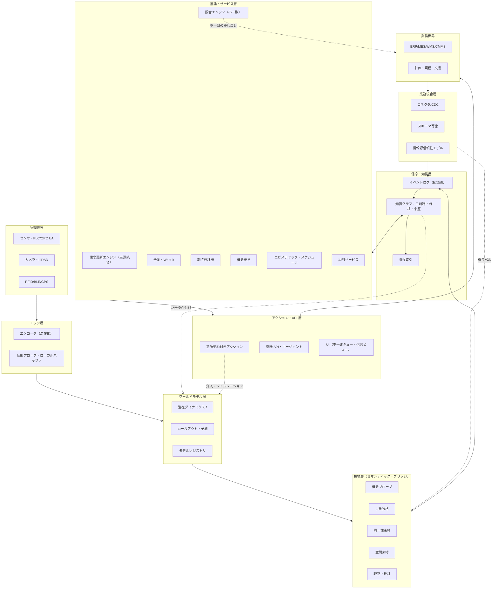
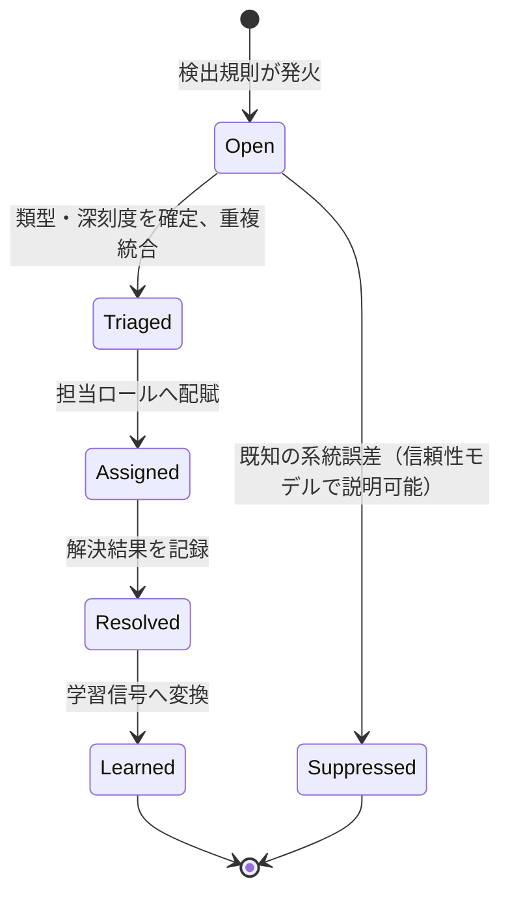
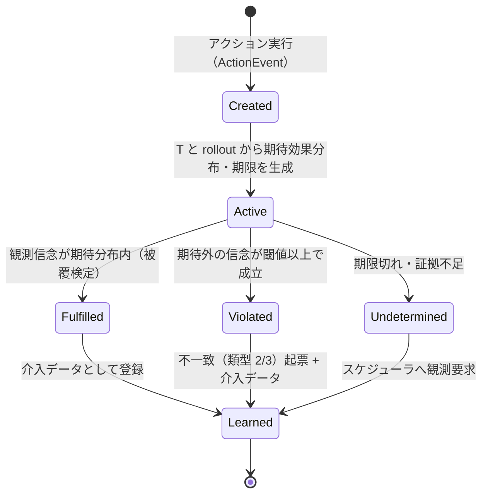
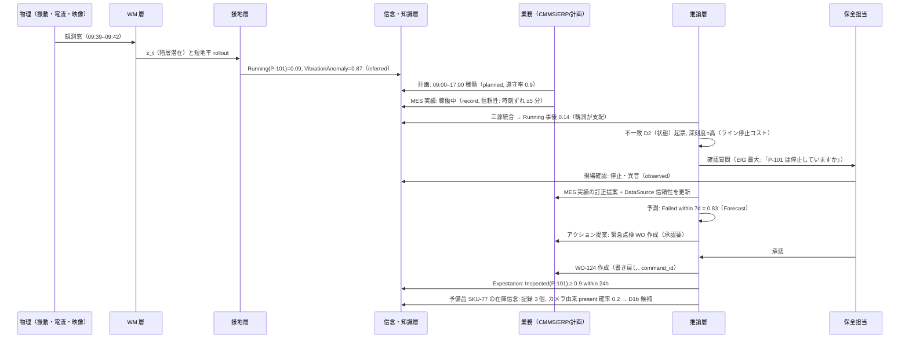

# 物理−業務セマンティック・ブリッジ基盤（SBP）詳細設計書

**Semantic Bridge Platform — World Model × Ontology による知的データ基盤** — v0.1（2026-09-29）

---

## 0. 本書の位置づけ

### 0.1 目的と読者

本書は、ワールドモデル（WM）とオントロジーを組み合わせ、物理世界（センサ・カメラ・設備・人・モノ）とデジタルな業務世界（ERP/MES/WMS/CMMS・計画・規程・文書）を意味的に接続する知的データ基盤の詳細設計を定める。読者はアーキテクト、データ/ML エンジニア、オントロジー担当、業務側のドメインオーナーを想定する。

### 0.2 設計上の前提（明示する仮定）

| # | 仮定 | 外れた場合の影響 |
|---|---|---|
| A1 | 物理側に少なくとも一種類の連続観測（時系列・映像・位置のいずれか）が継続的に取得できる | WM 層が成立しない。規則ベース検出器のみで運用（Phase 0 相当） |
| A2 | 業務側に、物理実体を指す ID（資産 ID・SKU・ロット・作業指示番号）を持つ記録が存在する | 同一性束縛の起点が無く、照合は「存在不一致」に限定される |
| A3 | 業務記録は誤りうる（遅延・テンプレ入力・締め処理）ことを組織が認める | 基盤は照合ツールではなく報告ツールに退化する |
| A4 | 初期スコープは 1 ドメイン・1〜2 拠点。多拠点連合は Phase 3 | 初期から多拠点だと、オントロジーと WM の共進化が収束しない |
| A5 | 生映像に人が映りうる区域が存在する | プライバシー設計（エッジ潜在化、非保持）が必須要件になる |

### 0.3 中核テーゼ（設計の背骨）

1. **真実ではなく信念を管理する。** センサは壊れ、モデルは幻覚し、記録は歪む。基盤は三つの情報源（物理観測・業務記録・計画/規範）を、オントロジーで構造化された確率的信念として維持・照合・予測する「信念維持システム」である。
2. **すべての事実は誰かの主張である。** 業務記録も WM の推定も予測も、物理実体「についての」情報内容実体（ICE）であり、来歴と様相が異なるだけ。
3. **接地は分類ではなく写像の対である。** シンボル→潜在領域（grounding）と潜在軌道→記号的事象（abstraction）を双方向に持ち、両者のダイナミクスが近似的に可換であること（A∘f ≈ T∘A）を整合条件とする。
4. **イベントが第一、状態は投影。** 物理事象も業務事象も意味型付きイベントログに落とし、状態はそこからの投影として再計算可能にする。
5. **不一致は例外ではなく製品。** 物理と業務の食い違いを一級のオブジェクトとして扱い、その解決結果を学習信号に変える。

---

## 1. 目的・スコープ・要求

### 1.1 ミッション

「いま物理世界で何が起きているか」「業務システムは何と言っているか」「本来どうあるべきか」の三者を、同じ語彙・同じ時間軸・同じ確信度尺度の上で突き合わせ、予測し、行動につなげる。

### 1.2 想定ドメイン（初期候補）

| ドメイン | 物理側 | 業務側 | 最初に狙う不一致 |
|---|---|---|---|
| 製造・設備保全 | 振動・電流・温度、映像、PLC 状態 | CMMS 作業指示、MES 稼働実績、保全計画 | 状態不一致（稼働/停止）、未実施作業 |
| 倉庫・在庫 | カメラ、RFID/BLE、フォークリフト位置 | WMS 在庫・入出庫、ERP 受発注 | 存在不一致（幽霊在庫・未計上）、同一性不一致 |
| 施設・エネルギー | BMS 計測、人感、電力 | 生産計画、契約デマンド、規程 | 規範不一致（契約超過）、計画との乖離 |
| 物流ヤード | 車両・パレット追跡、ゲート | 配車計画、出荷伝票、SLA | 時間不一致、SLA 違反予兆 |

### 1.3 機能要求

| ID | 要求 | 実現層 |
|---|---|---|
| FR-01 | 物理観測から潜在状態を推定し、任意地平の予測分布を返せる | WM 層 |
| FR-02 | オントロジーの概念・属性を潜在状態に接地し、較正された確信度付きで記号化できる | 接地層 |
| FR-03 | 物理個体と業務 ID を証拠付きで束縛し、撤回できる | 接地層 |
| FR-04 | 全アサーションを二時制（有効時間・記録時間）＋様相＋確信度＋来歴付きで保持し、as-of クエリに応答できる | 信念・知識層 |
| FR-05 | 業務システムの記録・計画・規程を同一の事象モデルへ写像できる | 業務統合層 |
| FR-06 | 三源（観測・記録・計画）を統合した事後信念を維持できる | 推論層 |
| FR-07 | 五類型の不一致を検出・起票・追跡し、解決結果を学習に還元できる | 推論層 |
| FR-08 | アクションに意味契約（前提・期待効果）を付し、実行後に効果を自動検証できる | アクション層 |
| FR-09 | 業務計画の What-if を物理シミュレーションとして評価できる | 推論層 + WM 層 |
| FR-10 | オントロジー・モデル・プローブの版更新後、過去データを再接地できる | 信念・知識層 |
| FR-11 | 説明要求に対し、記号側（規則・記録）と潜在側（プローブ・観測窓）を接合した根拠を返せる | 推論層 |
| FR-12 | 不確実性削減の価値に基づき、追加観測・人への確認・記録照合を計画できる | 推論層 |
| FR-13 | 未接地の潜在構造から候補概念を提案し、人の curation を経てオントロジーを版上げできる | 推論層 + ガバナンス |
| FR-14 | LLM エージェントが意味 API 経由で信念の読み書き・アクション実行を権限内で行える | API 層 |

### 1.4 非機能要求

| 区分 | 要求 |
|---|---|
| レイテンシ階層 | L0 エッジ反射: < 100 ms（局所安全）／L1 拠点信念更新: < 1 s／L2 照合・起票: < 60 s／L3 バッチ（再接地・学習）: 時間単位 |
| スループット | 拠点あたりセンサ事象 10⁴〜10⁶ /s（潜在化後は 10²〜10³ /s の潜在ベクトル）、業務事象 10²〜10⁴ /日 |
| 可用性 | 知識層 99.9%、エッジ/拠点はネット断でも 24 h 以上自律動作（ローカルバッファ・ローカル信念） |
| 保持 | raw 30〜90 日（人の映る区域は非保持）、latent 1〜2 年、symbolic 無期限（二時制で非破壊） |
| 監査性 | 任意のアサーションから証拠まで 3 ホップ以内で到達可能、モデル版・オントロジー版が復元可能 |
| プライバシー | 生映像の拠点外持ち出し禁止、潜在からの復元攻撃耐性を定期検証、概念型単位のアクセス制御 |
| 拡張性 | 新拠点追加はオントロジー変更なしで可能、新概念追加は既存プローブを壊さない（加法的版更新） |
| 説明責任 | 高影響アクションは人の承認を必須化できる（設定可能な閾値） |

### 1.5 スコープ外

ロボット制御ループそのもの（基盤は状態と意味を供給するが、モーションプランニングは行わない）、業務システムの代替（ERP/MES は system of record のまま）、汎用 LLM チャットボット。

### 1.6 設計原則

| # | 原則 | 具体的な帰結 |
|---|---|---|
| P1 | 信念 > 真実 | 「正」フラグを持たない。すべて確信度と来歴 |
| P2 | 双方向・動的接地 | 静的分類精度だけでプローブを採用しない。整合残差を必須指標にする |
| P3 | イベント第一 | 状態ストアは常にイベントログから再構築可能 |
| P4 | 三時制を省略しない | 有効時間・記録時間・予測地平を全アサーションに持つ |
| P5 | 不一致は製品 | 検出→起票→解決→学習の閉ループを製品機能として作る |
| P6 | 最小オントロジー・観測駆動成長 | 初期 20〜30 型。概念発見ループで育てる |
| P7 | 記号→潜在も条件付ける | 業務文脈を WM の入力にする（ただし監査対象の記録は入力から隔離） |
| P8 | 再計算可能性 | raw/latent/版を保持し、再接地できる |
| P9 | 意味圧縮の外向き原則 | 拠点外へ出すのは raw より latent、latent より symbolic |
| P10 | 標準優先・独自最小 | 上位/観測/来歴/時間/空間は標準採用、独自は Situation・Discrepancy 等の接続概念のみ |

---

## 2. 概念モデルと全体アーキテクチャ

### 2.1 三つの世界と一つの信念

- **物理世界**：連続・高次元・部分観測・慣性を持つ。真の状態は観測できず、WM が潜在状態 z として推定する。
- **記号世界（業務）**：離散・明示・断定的。トランザクションとして記録されるが、遅延と誤りを含む。
- **規範世界**：計画（こうする予定）と規程・契約（こうあるべき）。事前分布と制約を与える。
- **信念**：三者を統合した、オントロジー型付きの確率的状態。基盤が唯一「所有」するもの。

### 2.2 用語

| 用語 | 定義 |
|---|---|
| 潜在状態 z | WM が観測窓から推定する連続ベクトル（階層・時間スケール付き） |
| プローブ φ_C / ψ_p | 概念 C の成立確率 / 属性 p の値分布を z から出力する学習器 |
| 抽象化写像 A | プローブ群の出力を束ねた記号状態（確率付き事実集合） |
| 記号遷移 T | プロセスオントロジー（事象計算）から導かれる記号状態の遷移 |
| 整合残差 | ‖A(f(z,a)) − T(A(z),a)‖。WM と オントロジーの可換性の破れ |
| 様相 | 事実の身分：observed / inferred / predicted / planned / normative / hypothetical |
| ICE | 情報内容実体。記録・観測・予測・計画・規範・説明のすべて |
| Situation | 時空間領域＋参加者＋関係＋解決状態を束ねる単位 |
| Discrepancy | 物理と業務の食い違いを表す一級オブジェクト（五類型） |
| Expectation | アクション実行時に生成される、期待効果と期限を持つ検証対象 |
| IdentityClaim | 物理トラックと業務 ID の束縛主張（証拠・確信度・有効期間付き） |
| 再接地 | 版更新後に latent から記号状態を再計算する処理 |

### 2.3 全体アーキテクチャ



### 2.4 層の責務と非責務

| 層 | 責務 | 非責務 |
|---|---|---|
| エッジ | 観測の時刻同期、潜在化、局所安全のための反射プローブ、断線時バッファ | 意味の確定、業務記録の参照 |
| WM | 潜在状態推定、遷移、予測、介入シミュレーション | 記号の決定、業務規則の適用 |
| 接地 | 記号化、事象昇格、同一性・空間束縛、較正、制約検証 | 状態の永続化、信念統合 |
| 信念・知識 | イベントログ、二時制・様相・来歴付き知識グラフ、潜在索引、再接地 | 推論ロジック、UI |
| 業務統合 | コネクタ、写像、業務事象化、信頼性モデル、書き戻し | 業務システムの代替 |
| 推論・サービス | 三源統合、照合、予測、What-if、期待検証、概念発見、スケジューリング、説明 | データ永続化 |
| アクション・API | 意味契約、承認、実行、API、エージェント、UI | モデル学習 |

### 2.5 三つのデータパス

1. **推定パス**（物理→信念）：観測 → 潜在 z → プローブ → 型付き確率的事象 → イベントログ → 信念更新。
2. **記録パス**（業務→信念）：CDC/API → スキーマ写像 → BusinessEvent（信頼性メタ付き）→ イベントログ → 信念更新。
3. **アクションパス**（信念→業務・物理）：意思決定 → 意味契約検証 → 承認 → 実行（書き戻し／指令）→ Expectation 生成 → 検証 → 学習。

---

## 3. オントロジー設計

### 3.1 層構造

| 層 | 内容 | 変更頻度 | オーナー |
|---|---|---|---|
| L0 上位 | BFO（continuant / occurrent / quality / role）、IAO（ICE, is_about）、PROV-O、OWL-Time、GeoSPARQL、QUDT、SOSA/SSN | ほぼ不変 | 基盤チーム |
| L1 SBP 中核 | Situation、Fluent、Modality、Discrepancy、Expectation、IdentityClaim、Track、Anchor、Probe、ModelVersion | 年数回 | 基盤チーム |
| L2 ドメイン | ISO 15926/CFIHOS、AAS サブモデル、OPC UA 情報モデル、Brick、EPCIS 2.0、SAREF、GS1 | 標準の改訂に追随 | ドメインオーナー |
| L3 企業 | オブジェクト型・リンク型・アクション型・関数型、企業固有の状態機械・規程 | 月次 | 業務オーナー |
| L4 アプリ | 画面・エージェント向けのビューと派生属性 | 週次 | アプリチーム |

上位層は標準を採用して独自定義を避ける。独自性は L1 の「接続概念」に集中させる。

### 3.2 上位区分の使い分け

- **continuant（存在物）**：Asset、MaterialItem、Person、Vehicle、Location。時間を通じて同一性を保つ。
- **occurrent（生起物）**：Process（継続する）、Event（瞬間的〜短時間）。WM が主に扱う対象。
- **quality（性質）**：温度・振動・数量。SOSA の ObservableProperty に対応。
- **role（役割）**：Person が Situation 内で担う Operator / Inspector。型ではなく役割として扱う。
- **ICE（情報内容実体）**：Observation、Forecast、Record、PlanItem、Norm、Explanation、Assertion。すべて `is_about` で物理実体を指す。

### 3.3 SBP 中核クラス

| クラス | 上位 | 説明 | 主要属性・関係 |
|---|---|---|---|
| PhysicalEntity | continuant | 物理的に存在する実体の総称 | hasLocation, hasPart, identifiedBy |
| Asset | PhysicalEntity | 設備・機器 | assetId, assetType, lifecycleState |
| MaterialItem | PhysicalEntity | 部品・製品・在庫単位 | sku, lot, quantity(QUDT) |
| Person | PhysicalEntity ∧ Agent | 人（役割は Situation 内で付与） | — （個人特定属性は原則保持しない） |
| Carrier | PhysicalEntity | パレット・コンテナ・車両 | carrierId |
| UnidentifiedPhysicalObject | PhysicalEntity | 業務 ID に未束縛の物理個体 | track, firstSeen, lastSeen, appearanceEmbeddingRef |
| Location | continuant | 施設・建屋・ライン・セル・ドック・棚 | geometry, coordinateFrame, containedIn |
| Zone | Location | 述語的な領域（危険区域、保管区画） | polygon/volume, zoneType |
| FluentType | ICE(schema) | 状態述語の型（Running, Present, Occupied…） | subjectType, valueDomain, mutuallyExclusiveWith |
| EventType | ICE(schema) | 事象の型（StartCmd, Fault, GoodsReceipt…） | initiates, terminates, participantsSchema |
| PhysicalEvent | occurrent | 観測・推定された物理事象 | subject, interval, evidence |
| BusinessEvent | occurrent | 業務トランザクション | source, recordRef, postingTime |
| ActionEvent | occurrent | 基盤経由のアクション実行 | action, actor, approvals |
| Process | occurrent | 継続する物理/業務プロセス | phases, participants |
| Situation | occurrent | 時空間領域＋参加者＋関係＋解決状態 | spatialExtent, temporalExtent, hasParticipant, status |
| Observation | ICE(SOSA) | センサまたは仮想センサ（WM）の観測 | madeBySensor, hasResult, resultTime, featureOfInterest |
| Forecast | Observation | 地平付き予測 | horizonOrigin, leadTime, conditionedOn |
| Record | ICE | 業務記録（伝票・作業指示・検査票） | source, recordedAt, reliabilityProfile |
| PlanItem | ICE | 計画・スケジュール項目 | plannedInterval, target, adherencePrior |
| Norm | ICE | 規程・契約条項・安全規則 | ruleRef(Datalog/SHACL), sourceDocument, severity |
| ActionType | ICE(schema) | 実行可能なアクションの型 | preconditions, effects, riskClass, requiredApprovals |
| Expectation | ICE | 期待効果と期限 | action, expectedEffects(dist), deadline, status |
| Discrepancy | ICE | 物理−業務の不一致 | kind(1..5), subjects, evidence, severity, status, resolution |
| IdentityClaim | ICE | 物理トラック↔業務 ID の束縛主張 | track, entity, evidence, confidence, validInterval |
| Track | ICE | 知覚が生成する時空間トラック | tracklets, frame, embeddingRef |
| Anchor | PhysicalEntity ∧ Sensor | 同一性束縛の基準点 | anchorKind(fixed/mobile/inferential), pose |
| Probe | ICE | 概念/属性プローブの登録 | grounds(concept), wmVersion, metrics, calibration, status |
| WorldModelVersion | ICE | WM の版 | domain, latentSpec, trainingProvenance |
| OntologyVersion | ICE | オントロジー版 | semver, changelog, compatibility |
| DataSource | Agent | 業務システム・センサ群 | reliabilityModel, clockProfile |

### 3.4 主要関係

| 関係 | 定義域 → 値域 | 意味 |
|---|---|---|
| is_about | ICE → PhysicalEntity ∨ occurrent | 主張の対象 |
| hasParticipant | Situation ∨ Event → PhysicalEntity | 参加者（役割付き修飾可） |
| occursAt / locatedIn | occurrent ∨ PhysicalEntity → Location | 空間位置（派生述語） |
| holdsAt | (FluentType, PhysicalEntity) → interval | 状態が成立する有効時間 |
| initiates / terminates | EventType → FluentType | 事象計算の規則（条件・遅延分布付き） |
| evidenceFor | ICE → Assertion | 根拠 |
| wasDerivedFrom / wasGeneratedBy / wasAttributedTo | PROV-O | 来歴 |
| groundedBy | Concept ∨ Property → Probe | 接地の実装 |
| boundTo | Track → PhysicalEntity（IdentityClaim 経由） | 同一性束縛 |
| targets / expects | Action → PhysicalEntity / Expectation | アクションの対象と期待 |
| concerns | Discrepancy → Assertion ∨ PhysicalEntity | 不一致の対象 |
| conditionedOn | Forecast → PlanItem ∨ Assertion | 予測の条件 |
| mutuallyExclusiveWith | FluentType → FluentType | 排他制約（検証に使用） |

### 3.5 信念メタデータ（全アサーション共通）

すべてのアサーションは以下の組を持つ。RDF では RDF-star（文への注釈）、プロパティグラフでは辺プロパティで実装する。

| フィールド | 型 | 意味 |
|---|---|---|
| subject / predicate / object | IRI / IRI / IRI∨literal | 主張本体 |
| valid_from / valid_to | xsd:dateTime（右開） | 有効時間 |
| tx_from / tx_to | xsd:dateTime（右開） | 記録時間（基盤がそう信じていた期間） |
| modality | enum | observed / inferred / predicted / planned / normative / hypothetical |
| belief | 構造体 | boolean: p∈[0,1]／categorical: pmf／numeric: (mean, var, quantiles) または samples 参照 |
| horizon_origin / lead_time | dateTime / duration | predicted のみ |
| provenance | IRI（PROV bundle） | 生成活動・エージェント・モデル版・証拠集合 |
| source_reliability | IRI | 適用した信頼性モデル |
| situation | IRI | 属する Situation（任意） |
| scenario | IRI | hypothetical のみ。What-if シナリオ識別子 |

様相は格子として扱う：observed < inferred < predicted < planned（確からしさの順ではなく「事実性の身分」の順）、normative は直交、hypothetical は主信念グラフに昇格しない限り隔離される。

### 3.6 時間モデル

- **三時制**：有効時間（現実にそうであった期間）、記録時間（基盤がそう信じていた期間）、予測地平（predicted の起点と先行時間）。
- **二つの時計**：物理時計（PTP/NTP 同期、エッジ受信時刻とセンサ時刻を両方保持）と業務時計（伝票日付・計上日・締め）。
- **許容プロファイル**：DataSource ごとに時刻ずれの分布を持つ（例：MES ±5 分、ERP 入庫は同日内、手書き日報 ±1 シフト）。時間不一致（類型 3）の判定閾値はここから導く。
- **区間代数**：Allen の 13 関係を holdsAt / occursDuring の比較に用いる。

### 3.7 空間モデル

- 施設ごとに**施設座標系**（原点・軸・単位）を定義し、屋外は測地系との変換を持つ。
- Zone は施設座標系上のポリゴン/ボリューム。`locatedIn` は位置分布（平均・共分散）と Zone の包含確率から派生する確率的述語。
- カメラ・リーダは Anchor として外部パラメータ（pose）を持ち、知覚出力を施設座標系へ変換する。

### 3.8 プロセス・オントロジー（事象計算）

FluentType と EventType の間の initiates / terminates 規則を、条件と遅延分布付きで記述する。

```text
FluentType Running(a: Asset)
FluentType UnderMaintenance(a: Asset)   mutuallyExclusiveWith Running
EventType  StartCmd(a), StopCmd(a), MaintStart(a), MaintEnd(a), Fault(a)

Initiates(StartCmd(a), Running(a))     if not UnderMaintenance(a)   delay ~ LogNormal(μ=ln 30s, σ=0.5)
Terminates(StopCmd(a), Running(a))                                   delay ~ LogNormal(μ=ln 10s, σ=0.4)
Terminates(Fault(a), Running(a))                                     delay ~ Exponential(1/5s)
Initiates(MaintStart(a), UnderMaintenance(a))
Terminates(MaintEnd(a), UnderMaintenance(a))
```

この記述は三通りにコンパイルされる：(1) 記号遷移 T（整合残差の計算用、Datalog/ASP）、(2) 信念更新エンジンの遷移事前分布（半マルコフ滞在時間）、(3) 事象昇格の逆写像（フルーエントの変化から起こったはずの事象型を推定）。

### 3.9 制約と推論

- **構造制約（SHACL, Violation）**：Asset は必ず Location を持つ、IdentityClaim は Track と Entity を持つ等。違反はイベントログへの登録を拒否せず「隔離キュー」に回す。
- **整合制約（SHACL, Warning）**：排他フルーエントが同一有効時間に共に確信度 > 0.5 で成立 → 不一致候補を生成する。**検証は拒否ではなく証拠生成**として設計する。
- **推論**：OWL RL 相当の型推論と、Datalog による派生述語（locatedIn の包含推移、部分−全体の集約、規範違反判定）。閉世界は個別述語に限定して宣言する（既定は開世界）。

### 3.10 企業層：オブジェクト・リンク・アクション・関数

| 型 | 対応 | 例 |
|---|---|---|
| ObjectType | L1/L2 クラスの業務向けビュー | Pump（Asset の下位）、WorkOrder（Record の下位） |
| LinkType | 関係のビュー | WorkOrder → targets → Pump |
| ActionType | 意味契約付きアクション | CreateWorkOrder, ReleaseProductionOrder, AdjustInventory |
| FunctionType | 派生属性（実装は規則・プローブ・予測クエリ） | predictedFailureWithin7d（Forecast クエリ）, physicallyPresent（信念クエリ） |

FunctionType が WM の予測や信念に裏打ちされることで、業務側の画面や API は「物理接地された属性」を通常の属性と同じ顔で扱える。

### 3.11 標準の採用マッピング

| 目的 | 標準 | 使い方 |
|---|---|---|
| 上位区分 | BFO 2020 | continuant/occurrent/quality/role の骨格 |
| 主張と対象 | IAO | ICE と is_about |
| 観測・仮想センサ | SOSA/SSN | センサ値・WM 推定・予測の統一記述 |
| 来歴 | PROV-O | 活動・エージェント・派生の連鎖 |
| 時間・空間・単位 | OWL-Time / GeoSPARQL / QUDT | 区間、幾何、単位付き量 |
| 産業資産 | ISO 15926, CFIHOS, AAS, OPC UA | 設備分類・属性辞書・情報モデル |
| 建物 | Brick | 空間と設備の関係 |
| サプライチェーン事象 | EPCIS 2.0 | what/when/where/why/how の事象共通枠 |
| IoT | SAREF | デバイスと機能 |
| 利用目的制約 | ODRL | データ利用ポリシー |

### 3.12 ID・命名・版管理規約

- IRI 名前空間：`sbp-core:`（L1）、`dom-*:`（L2）、`ent:`（企業）、`site-<id>:`（拠点個体）。
- イベント ID は UUIDv7（時刻順序性）、実体 ID は業務 ID から派生した安定 IRI＋内部サロゲート。
- オントロジー版は semver：MAJOR＝クラス/関係の削除・意味変更、MINOR＝加法的追加、PATCH＝注釈。MINOR までは既存プローブ・クエリを壊さないことを CI で検証する。
- 非推奨は最低 2 MINOR 版の猶予を置き、`owl:deprecated` と後継指定を必須にする。

---

## 4. ワールドモデル層設計

### 4.1 責務

観測窓から潜在状態 z を推定し、アクションと文脈に条件付いた遷移 f を学び、任意地平のロールアウトを分布として返す。記号の決定は行わない（接地層の責務）。

### 4.2 モデル族の選定

| 物理ドメイン | 推奨族 | 潜在の性質 | 採用理由 | 注意 |
|---|---|---|---|---|
| 映像・空間（倉庫、ヤード、ライン） | JEPA 系の潜在予測モデル＋3D シーン表現（占有・スプラッティング） | 高次元・幾何を暗黙に保持 | 画素再構成を避け照明・雑音に頑健。プローブが線形で済むことが多い | 生成型映像 WM は可視化・合成データ用途に限定 |
| 設備・プロセス（回転機、反応器） | Koopman 作用素モデル、Neural ODE / PINN、RSSM | 線形化された遷移、物理則の埋め込み | Koopman 固有関数がフルーエントに対応づけやすく、整合残差が解釈しやすい | 非定常運転では作用素の切替（モード）が必要 |
| ネットワーク（物流、電力、配管） | GNN シミュレータ | ノード/エッジ潜在 | オントロジーの部分−全体・接続構造をそのまま入力にできる | 計算コストは辺数に比例 |
| 人・流れ | エージェントベース＋学習補正 | 個体潜在＋場 | 介入（導線変更）の What-if に強い | 個人特定を避ける集約設計 |
| 多変量時系列一般 | 状態空間モデル / Transformer 系 | 汎用 | ベースライン | 長地平で発散しやすい |

### 4.3 共通インタフェース

```text
interface WorldModel {
  meta: { id, version, domain, modalities[], latentSpec{dims, levels, timescales}, trainingProvenance }

  encode(obsWindow, context?)              -> LatentState   // z と不確実性（共分散 or アンサンブル）
  step(z, action?, context?)               -> LatentState
  rollout(z, actionSeqOrPolicy, horizon, nSamples, context?) -> Trajectory[]   // サンプル軌道
  probe(z, probeIds[])                     -> { probeId: Distribution }
  explain(z, probeId)                      -> Attribution   // 入力モダリティ・時間窓・潜在次元への帰属
  embed(z, level)                          -> Vector        // 潜在索引用
  health()                                 -> { latentShift, predError, alignResidual }
}
```

`context` は記号条件付けベクトル（§4.4）。`action` はオントロジーの ActionType インスタンスを WM 入力へ写像したもの（介入エンコーダ）。

### 4.4 潜在状態の設計

- **階層潜在**：L-fast（ms〜s：センサ挙動）、L-mid（分：設備状態）、L-slow（時間〜日：劣化・在庫水位）。各階層に別のプローブ群を持ち、部分−全体の集約制約で整合させる。
- **記号条件付け**：オントロジー実例グラフの k-hop 近傍（型・現在の信念・PlanItem・Norm）を GNN で埋め込み、`context` として f に入力する。
- **監査隔離**：ある記録を監査するための推定に、その記録自身（およびそれから派生した信念）を入力しない。条件付けベクトルは「監査対象マスク」を適用して生成する。
- **不確実性**：アンサンブル（3〜5）または潜在ガウス。プローブは分布を受け取り、出力分布に伝播させる。

### 4.5 学習パイプライン

| 段階 | データ | 目的 | ゲート |
|---|---|---|---|
| 1. 自己教師事前学習 | raw/latent ストリーム | 潜在予測（JEPA 型）、物理則損失 | 予測誤差・潜在崩壊指標 |
| 2. 記号条件付け学習 | 1 + 実例グラフ | 文脈依存の遷移 | 条件付き予測改善 |
| 3. 弱教師プローブ学習 | 業務記録由来の弱ラベル（§5.2） | φ_C, ψ_p | AUROC, MIL 一貫性 |
| 4. 論理制約注入 | オントロジー制約 | 排他・含意の違反抑制 | 制約違反率 |
| 5. 整合学習 | プロセスオントロジー T | 準同型残差の最小化 | 残差分布 |
| 6. 較正 | 保留データ | 温度スケーリング、conformal | ECE, 被覆率 |
| 7. 能動学習 | 不確実・不一致箇所 | ラベル効率 | 学習曲線 |

### 4.6 損失の構成

```text
L = L_pred(潜在予測)
  + λ_phys · L_phys(物理則・保存量)
  + λ_probe · L_probe(弱ラベル；時間バッグ単位の多重インスタンス損失)
  + λ_logic · L_logic(制約の t-ノルム緩和；Logic Tensor Networks / semantic loss)
  + λ_align · Σ_(z,a) ‖A(f(z,a)) − T(A(z),a)‖²
```

λ は段階ごとにスケジュールし、整合損失は後期に強める（初期から強いと潜在が記号に過剰適合する）。

### 4.7 推論配置とレイテンシ階層

| 階層 | 配置 | 内容 | 目標 |
|---|---|---|---|
| L0 | エッジ | エンコーダ、反射プローブ（危険区域侵入等） | < 100 ms |
| L1 | 拠点 | 遷移・短地平予測、全プローブ、事象昇格 | < 1 s |
| L2 | 拠点/中央 | 長地平ロールアウト、What-if | 秒〜分 |
| L3 | 中央 | 学習、再接地、ドリフト分析 | 時間 |

拠点はネット断時に L0/L1 を継続し、イベントをローカルログに蓄積、復旧後に順序保証付きで同期する。

### 4.8 レジストリ・版・ドリフト

- レジストリは WorldModelVersion をオントロジーに登録し、プローブと互換性行列を持つ。
- ドリフト監視：潜在分布シフト（MMD / PSI）、予測誤差の推移、整合残差の推移、プローブ較正の劣化。閾値超過でシャドウ評価→再学習を起動。
- 昇格はカナリア（一部拠点・一部概念）→全体。旧版の推定は tx 時間で残る。

---

## 5. 接地層（セマンティック・ブリッジ）設計

### 5.1 構成要素

| 要素 | 入力 | 出力 |
|---|---|---|
| 概念プローブ | z（分布） | 概念成立確率、属性値分布 |
| 事象昇格 | プローブ出力の時系列 | PhysicalEvent（区間・確信度・推定事象型） |
| 同一性束縛 | Track、Anchor 観測、業務文脈 | IdentityClaim / UnidentifiedPhysicalObject |
| 空間束縛 | 位置分布、Zone | locatedIn 確率 |
| 較正 | プローブ生出力 | 較正済み確率・予測集合 |
| 検証 | 型付き事象、制約 | 隔離／警告／不一致候補 |

### 5.2 概念プローブ仕様

- **種類**：分類（φ_C: Z→[0,1]）、回帰（ψ_p: Z→Dist(V_p)）、検出（時空間局在）。
- **実装方針**：まず線形プローブ（潜在の品質検査を兼ねる）、不足時のみ小型ヘッド。非線形が必要な概念は「潜在が概念を線形分離できない」というシグナルとして WM 改善候補に回す。
- **弱ラベルの生成**：Record → (概念, 実体, 時間バッグ) の三つ組。例：「WO-123 軸受交換 完了 9/12」→ (UnderMaintenance, P-101, [9/12 08:00, 9/12 17:00]) を正例バッグとする。バッグ内の少なくとも一区間で成立、という多重インスタンス仮定で学習する。
- **ラベル重み**：DataSource の信頼性モデルから導く（§7.3）。
- **登録メタデータ**：probe_id、接地する概念 IRI、対応 WM 版、学習データ来歴、評価指標（AUROC/ECE/整合残差）、較正パラメータ、有効ドメイン（拠点・運転モード）、状態（candidate / active / deprecated）。
- **採用基準**：AUROC ≥ 0.85 かつ ECE ≤ 0.05 かつ整合残差が既存プローブの中央値以下。三条件の AND。

### 5.3 事象昇格

1. プローブ出力列に対し、オンライン変化点検出（Bayesian online change-point または CUSUM）でフルーエントの変化候補を得る。
2. ヒステリシス（上昇 0.7 / 下降 0.3）と最小持続時間で瞬時のちらつきを除く。
3. プロセスオントロジーの逆写像で「起きたはずの事象型」を推定（Running が真→偽なら StopCmd か Fault。区別は他プローブ〈振動急変〉と業務文脈〈停止指令の記録〉の尤度で）。
4. 有効区間（変化点±不確実幅）と確信度を付与し、既存事象と重複抑制（同一実体・同型・区間重なり）。
5. TypedProbabilisticEvent としてイベントログへ出力。

### 5.4 同一性束縛

- **Track**：知覚が生成する時空間軌跡＋外観埋め込み。Track はまず UnidentifiedPhysicalObject として知識層に存在する（業務が知らない物を表現できる）。
- **アンカー種別**：固定（較正済みカメラ、ゲート、RFID/BLE リーダ）、可搬（タグ）、推論（時空間連続性＋業務文脈：「ドック 3 を今出たパレットは配車計画上 出荷 #123」）。
- **束縛アルゴリズム**：Track 集合と候補実体集合の割当問題。コスト = −log P(match | 外観類似, 時空間整合, 業務事前)。小規模はハンガリアン法、多重仮説が必要な場合は JPDA/MHT。
- **IdentityClaim**：confidence、証拠、有効区間を持つ。新証拠で再計算し、閾値未満に落ちれば撤回して不一致類型 4 を起票。
- **禁止事項**：Person の Track は個人識別に用いない（役割・人数・位置のみ）。

### 5.5 空間束縛

位置分布 N(μ, Σ) と Zone 幾何から包含確率を計算し、`locatedIn` を確率的述語として出力する。階層（棚→区画→建屋）は包含推移で導出する。

### 5.6 較正・不確実性

- 分類：温度スケーリング＋信頼性ダイアグラムの定期監査。
- 回帰：conformal で予測区間、被覆率を監視。
- アンサンブル分散を「認識的不確実性」、較正後の分布を「偶然的不確実性」として分けて保持し、スケジューラ（§8.7）は認識的不確実性を対象にする。

### 5.7 検証と昇格ポリシー

| 条件 | 処置 |
|---|---|
| 構造制約違反 | 隔離キュー（登録しない、人が確認） |
| 排他フルーエント衝突 | 両方登録し、不一致候補（類型 2）を生成 |
| 確信度 < 0.3 | 登録するが信念更新の尤度としては弱く扱う（重み付き） |
| 整合残差 > 閾値 | 登録し、ドリフト監視へ通知 |

### 5.8 出力契約（TypedProbabilisticEvent）

```json
{
  "event_id": "018f5c7e-...-7f3a",
  "schema_version": "1.2",
  "type": "sbp-core:PhysicalEvent/ent:PumpStopped",
  "subject": "site-A:asset/P-101",
  "valid_time": { "start": "2026-09-12T09:41:30Z", "end": "2026-09-12T09:42:10Z", "uncertainty_s": 20 },
  "tx_time": "2026-09-12T09:42:12Z",
  "modality": "inferred",
  "belief": { "kind": "boolean", "p": 0.91 },
  "inferred_event_type": { "ent:StopCmd": 0.35, "ent:Fault": 0.56, "other": 0.09 },
  "evidence": [
    { "kind": "probe", "probe_id": "probe:running-v7", "wm_version": "wm:pump-koopman-3.2", "window": ["2026-09-12T09:39:00Z", "2026-09-12T09:42:00Z"] },
    { "kind": "probe", "probe_id": "probe:vibration-anomaly-v3", "p": 0.87 }
  ],
  "producer": { "agent": "bridge@site-A", "version": "2.4.1" },
  "situation": "site-A:sit/2026-09-12/line3-shift1",
  "alignment_residual": 0.08
}
```

---

## 6. 信念・知識層設計

### 6.1 イベントログ（記録源）

- **トピック設計**：`<site>.<layer>.<eventClass>`（例：`siteA.bridge.physical`, `siteA.integration.business`, `central.reasoning.discrepancy`）。パーティションキーは主体実体 IRI（実体単位の順序保証）。
- **エンベロープ**：event_id（UUIDv7）、schema_version、type、subject、valid_time、tx_time、modality、belief、evidence、producer、causation_id（起点イベント）、correlation_id（Situation）。
- **冪等性**：event_id による重複排除。書き戻し由来のイベントは command_id を保持し、再送に耐える。
- **順序**：実体単位で単調。拠点間は tx_time と因果 ID で整列（グローバル順序は要求しない）。
- **スキーマレジストリ**：JSON Schema をオントロジーの EventType から生成し、互換性検査（後方互換のみ許可）。
- **保持と圧縮**：無期限。定期スナップショット（信念状態）で再構築時間を抑える。

### 6.2 三層ストレージ

| 層 | 内容 | ストア | 保持 | 用途 |
|---|---|---|---|---|
| raw（冷） | センサ生値、映像（人の映る区域は非保持） | オブジェクトストア（暗号化） | 30〜90 日 | 再潜在化、監査 |
| latent（温） | 階層潜在 z、Track 埋め込み | 列指向（実体×時刻×階層） | 1〜2 年 | 再接地、類似検索、学習 |
| symbolic（熱） | イベント、アサーション、オブジェクト | グラフ＋イベントログ | 無期限 | クエリ、推論、UI |

版更新時は「latent から再接地」を既定とし、raw からの再潜在化は WM の MAJOR 更新時のみ。

### 6.3 知識グラフの物理設計

| 観点 | RDF/OWL/SHACL（RDF-star） | プロパティグラフ |
|---|---|---|
| 標準準拠・語彙再利用 | ◎ | △（写像が必要） |
| 文単位メタデータ | ◎ RDF-star | ○ 辺プロパティ（辺にしか付かない） |
| 推論 | ◎ OWL RL / SHACL rules | △ 外部エンジン |
| 開発体験・性能 | ○ | ◎ |
| 決定 | **主ストア**（標準性・来歴・推論を優先） | 派生ビュー（アプリ向け投影として生成可） |

- **名前付きグラフ戦略**：`<modality>/<site>/<ontologyVersion>` で分割。hypothetical はシナリオ単位の名前付きグラフに隔離。
- **索引**：(subject, predicate, valid_from) / (predicate, modality, tx_from) / (situation)。時間範囲クエリのために valid_time を数値化した補助索引を持つ。
- **パーティション**：拠点単位＋年単位。中央は拠点グラフのフェデレーション。

### 6.4 二時制の実装

- アサーションの訂正は上書きせず、旧文の tx_to を閉じ、新文を tx_from で開く（非破壊）。
- 「as-of T」クエリは tx_from ≤ T < tx_to の文だけを見る。「valid-at t」は valid_from ≤ t < valid_to。
- 予測は horizon_origin と lead_time を持ち、同一対象・同一有効時間に複数の予測（異なる起点）が共存する。最新起点を既定とし、予測の精度追跡（起点別誤差）に全履歴を使う。

### 6.5 潜在索引とハイブリッドクエリ

- ANN 索引（HNSW）を (実体型, 拠点, 階層) でシャーディング。キーは (実体, 時刻, 階層)。
- クエリプランナはグラフ述語をフィルタとして先に押し下げ、残った候補で近傍検索を行う（または逆。選択率で判断）。
- Situation 単位の埋め込み（参加者潜在の集約）を別索引に持ち、「似た状況」検索を可能にする。

### 6.6 クエリ言語拡張

SPARQL 1.1 ＋ RDF-star に、時制・様相・類似の拡張述語を SERVICE として提供する。

```sparql
PREFIX sbp: <https://sbp.example/core#>
PREFIX ent: <https://sbp.example/ent#>
SELECT ?pump ?p ?lead WHERE {
  ?pump a ent:Pump .
  << ?pump sbp:hasState ent:Failed >> sbp:modality sbp:Predicted ;
                                       sbp:leadTime ?lead ;
                                       sbp:confidence ?p ;
                                       sbp:horizonOrigin ?t0 .
  FILTER (?lead <= "P7D"^^xsd:duration && ?p >= 0.8)
  FILTER NOT EXISTS {
    ?wo a ent:WorkOrder ; ent:targets ?pump ; ent:status ent:Open .
  }
}
```

```sparql
# as-of と類似検索の併用：9/12 時点で信じていた状況のうち、現在の状況に似ていて SLA 違反に至ったもの
SELECT ?sit WHERE {
  SERVICE sbp:asOf { sbp:txTime "2026-09-12T18:00:00Z"^^xsd:dateTime }
  SERVICE sbp:latent { ?sit sbp:similarTo site-A:sit/current ; sbp:k 20 }
  ?sit a sbp:Situation ; sbp:status sbp:Resolved .
  << ?sit sbp:violates ent:SLA-Delivery-24h >> sbp:confidence ?c .
  FILTER (?c >= 0.7)
}
```

### 6.7 来歴設計

- PROV Activity：probe-run、rule-run、belief-update、reconciliation、llm-extraction、human-review、regrounding。
- PROV Agent：WorldModelVersion、Probe、Person（役割 IRI で匿名化可）、DataSource、LLM 版。
- コスト制御：文単位の来歴は「バンドル」単位にまとめ、証拠集合は参照で持つ。説明サービスが必要時に展開する。

### 6.8 再接地ジョブ

1. トリガ：OntologyVersion / Probe / WorldModelVersion の昇格、または不一致の遡及調査要求。
2. スコープ選択：影響を受ける概念・実体型・期間を依存グラフから算出し、コスト（latent 走査量）を見積もる。
3. 実行：latent 層を走査し、新版で A を再計算。新アサーションを新 tx_from で追加（旧版は tx_to を閉じるだけ）。
4. 差分レポート：確信度が閾値以上変化した文、新規/消滅した不一致を一覧化し、人の確認へ。

---

## 7. 業務統合層設計

### 7.1 コネクタ

| 種別 | 方式 | 例 |
|---|---|---|
| トランザクション | CDC（ログベース）、API ポーリング | ERP 伝票、MES 実績、WMS 入出庫、CMMS 作業指示 |
| 計画 | API / ファイル | 生産計画、配車計画、保全計画 |
| 規程・契約・文書 | 文書取込＋LLM 抽出 | 安全規程、SLA 条項、SOP |
| マスタ | 定期同期 | 資産台帳、SKU、拠点レイアウト |

### 7.2 スキーマ写像（関手的データ移行）

- 業務システムのスキーマを圏 S、オントロジーを圏 O とみなし、写像 F: S→O を定義する。データ移行は Σ_F（業務→オントロジーへの押し出し、結合と併合）、Δ_F（オントロジー側の問いを業務側へ引き戻し）で表現する。
- 実装は RML/R2RML（RDF 生成）＋写像 DSL。写像ごとに、キーの保存・必須制約の保存・多重度の保存を CI で検査する。
- 業務側スキーマ変更（列追加・意味変更）は写像の不変条件違反として検出し、写像の版を上げる。

### 7.3 業務事象化と情報源信頼性モデル

- 各トランザクションを BusinessEvent に変換し、Record（ICE）として保持。`is_about` で対象実体を指す。
- **信頼性モデル**（DataSource × 記録型ごと）：
  - 時刻ずれ分布（記録時刻 − 実際の発生時刻）
  - 誤記率・欠落率
  - 系統誤差（数量丸め、月末一括計上、テンプレ複写）
  - 尤度関数 P(record = x | 真の状態 s) の形（混同行列 or 連続誤差分布）
- パラメータは初期値を担当者ヒアリングで置き、解決済み不一致から継続推定する（§8.2）。

### 7.4 計画・規範の取り込み

- PlanItem → 様相 planned のアサーション（有効時間＝計画区間、確信度＝当該計画種の遵守率事前分布）。
- Norm → Datalog/SHACL 規則。条項の出典（文書・節）を来歴として保持。規則の適用結果は様相 normative の違反アサーション。

### 7.5 非構造文書の LLM 抽出

- オントロジーのスキーマ（クラス・関係・許容値）でガイドした構造化抽出。出力は根拠スパン（文書内位置）付き。
- 抽出結果は様相 inferred、来歴 llm-extraction（モデル版・プロンプト版）。オントロジー制約で検証し、高影響（規範・契約）は人の確認を必須化。
- LLM 出力は決して observed にしない。

### 7.6 書き戻し

- コマンドは冪等（command_id）。業務システムの応答は BusinessEvent として取り込み、アクションの ActionEvent と因果 ID で結ぶ。
- 失敗時は補償アクション（取消・差戻し）を ActionType に定義しておく。
- 書き戻し権限はアクション型単位で ABAC 制御（§11）。

---

## 8. 推論・サービス層設計

### 8.1 信念更新エンジン（三源ベイズ統合）

**状態**：実体ごとのフルーエント集合 s_t（オントロジー型付き）。関係（部分−全体、接続）は実体間の結合因子になる。

**因子**

| 因子 | 由来 | 形 |
|---|---|---|
| 遷移 P(s_t \| s_{t−1}, a, plan) | プロセスオントロジー T ＋滞在時間分布、PlanItem の遵守率 | 半マルコフ |
| 観測尤度 P(probe \| s) | 較正済みプローブ（ソフトエビデンス） | 尤度比 |
| 記録尤度 P(record \| s, source) | 信頼性モデル | 混同行列／誤差分布 |
| 関係制約 | 集約（部品の状態→設備の状態）、排他 | 因子ポテンシャル |

**推論**

- 実体単位の連鎖は前向きフィルタリング（HMM／半マルコフ）。
- 実体間結合は関係に沿ったメッセージパッシング（loopy BP）を一定周期で回す。大規模時は結合を「強い関係」（部分−全体、同一 Situation）に限定する。
- 数値フルーエントは粒子フィルタ（少数粒子）またはガウス近似。

```text
procedure update_belief(entity e, events E_t, records R_t, plan P_t):
  prior   ← transition(belief[e], actions(E_t), P_t)        # T と滞在時間、計画遵守率
  for ev in E_t where ev.modality ∈ {observed, inferred}:
      prior ← prior ⊙ likelihood_probe(ev)                   # 較正済み尤度比
  for r in R_t:
      prior ← prior ⊙ likelihood_record(r, reliability[r.source, r.type])
  posterior ← normalize(prior)
  for rel in strong_relations(e):
      send_message(rel, posterior)                           # 次周期のメッセージパッシングへ
  emit assertions(posterior, modality=inferred, provenance=bundle(E_t, R_t, P_t))
```

**出力**：様相 inferred のアサーション群（確信度＝事後）。計画・記録・観測のどれが事後を支配したかを来歴に残し、説明に使う。

### 8.2 照合エンジン（不一致）

**検出規則（五類型）**

| 類型 | 規則（概略） | 主なパラメータ |
|---|---|---|
| 1 存在 | (a) P(present(x, L)) ≥ θ_1 が τ 以上持続 ∧ 記録に x@L なし ／ (b) 記録 x@L ∧ P(present) ≤ 1−θ_1 が τ 以上持続 | θ_1=0.8, τ=source 依存 |
| 2 状態 | 観測由来事後と記録由来尤度の乖離 JS(p_obs ‖ p_rec) ≥ θ_2 が τ 以上持続 | θ_2=0.5 |
| 3 時間 | \|t_observed − t_recorded\| > 許容プロファイルの 95 パーセンタイル、または順序制約違反 | 時計プロファイル |
| 4 同一性 | IdentityClaim 撤回、競合クレーム（同一 Track に複数実体、同一実体に複数 Track） | 閾値 0.5 |
| 5 規範 | Norm 規則が確信度 ≥ θ_5 の信念上で違反 | θ_5=0.7 |

**深刻度**：severity = f(業務価値 v(x), 確信度, 持続時間, 規範重み)。v は ObjectType ごとに設定（資産価値、安全等級、SLA ペナルティ）。

**ライフサイクル**



**解決結果 → 学習信号**

| 解決結果 | 処置 |
|---|---|
| 物理が正しい | 記録訂正（書き戻し提案）、DataSource 信頼性モデルを更新（誤記率・時刻ずれ） |
| 記録が正しい | プローブ/WM の誤りとして負例バッグを生成、能動学習キューへ |
| 両方誤り | オントロジー欠落候補（§8.6）、Situation を保存 |
| 判定不能 | エピステミック・スケジューラへ追加観測要求 |

**重複統合**：同一実体・同一類型・区間重なりは一つに束ね、証拠を追加する。抑制規則は「信頼性モデルで説明できる系統誤差」（例：月末一括計上による時間不一致）に限定し、抑制も来歴に残す。

### 8.3 予測サービス

- 地平：短（分）、中（時間〜日）、長（週）。階層潜在に対応。
- 出力：SOSA Forecast として格納（horizon_origin、lead_time、conditionedOn）。
- 精度追跡：起点別に CRPS / 区間被覆率を記録し、地平ごとの「信頼できる先行時間」を公開する。
- 条件付け：PlanItem と現在の信念（記号条件付け）。計画変更時は再予測をトリガ。

### 8.4 シミュレーション・What-if

- **介入**：ActionType インスタンスを介入エンコーダで WM 入力に変換し、rollout を実行。結果は hypothetical 様相のシナリオグラフに格納。
- **業務 What-if**：計画の代替案（受注前倒し、保全繰り延べ）を PlanItem 差分として与え、記号条件付き rollout で物理効果（電力ピーク、稼働率、在庫水位）を分布として返す。
- **反実仮想**：解決済み Situation に対し、介入を差し替えて rollout（因果的妥当性は §8.5 の介入データ量に依存するため、妥当性スコアを併記）。
- シナリオの主信念への昇格は明示的操作のみ（決定として採用した計画は planned に昇格）。

### 8.5 期待オブジェクト検証器



- 期待効果は「フルーエント × 期限 × 分布」の集合。判定は予測区間被覆（conformal）またはベイズ因子。
- 検証結果は整合残差の実測値でもあり、WM とプロセスオントロジーのどちらが外れたかを、記号側期待（T 由来）と潜在側期待（rollout 由来）を別々に検証して切り分ける。

### 8.6 概念発見ループ

1. **検出**：(a) 潜在密度が高くプローブ最大活性が低い領域、(b) 整合残差が持続する領域、(c) 人手解決が繰り返される不一致（自由記述付き）。
2. **クラスタリング**：latent 索引上で密度クラスタリング。代表事例を抽出（人の映る区域は特徴量表示のみ）。
3. **提案**：LLM に、代表事例の記号的文脈（周辺の信念・Situation・自由記述）を与え、候補概念の名称・定義・上位概念・既存概念との排他/含意・想定される initiates/terminates 規則を生成させる。
4. **curation**：概念オーナーが採否・修正。採用時は MINOR 版として OntologyVersion を起票。
5. **接地**：候補概念のプローブを学習（クラスタ所属を弱ラベルに）、採用基準（§5.2）で審査。
6. **再接地**：過去 latent に適用し、遡及的に事実を追加。
7. **廃止**：一定期間発火しないプローブ・使われない概念は非推奨候補。

### 8.7 エピステミック・スケジューラ

- **候補クエリ q**：センサのサンプリング率変更、PTZ カメラの向き、追加センサの一時投入、人への確認質問、記録の再照合、部分棚卸。
- **効用**：U(q) = Σ_x v(x) · EIG_q(x) − c(q)。EIG は決定関連フルーエントの認識的不確実性の期待削減量（事前予測分布からサンプルして推定）。
- **制約**：人への質問頻度上限、センサ帯域、安全（PTZ の監視義務）。
- **選択**：貪欲＋劣モジュラ近似でバッチ選択。実行結果は observed 様相で戻り、信念更新へ。

```text
procedure schedule(budget):
  cands ← generate_queries(open_discrepancies, undetermined_expectations, high_entropy_fluents)
  for q in cands: q.utility ← Σ_x v(x)·EIG(q, x) − cost(q)
  chosen ← greedy_submodular(cands, budget, constraints)
  dispatch(chosen)   # 実行結果はイベントログへ（modality=observed）
```

### 8.8 説明サービス

- 入力：アサーション IRI（または不一致・期待）。
- 出力：説明グラフ＝(記号側：適用規則・参照記録・計画) ∪ (潜在側：寄与プローブ・観測窓・帰属)。三源のうちどれが事後を支配したかの寄与率を含む。
- as-of 指定で「当時の説明」を再構成できる（旧版のモデル・規則を来歴から解決）。

### 8.9 規則エンジン

Datalog（派生述語・規範判定・集約）と SHACL rules（形状に基づく推論）を併用し、規則の出典（Norm）を来歴に残す。規則の実行は信念上で行うため、確信度の伝播規則（最小値／積／noisy-OR）を規則ごとに宣言する。

---

## 9. アクション基盤と意味契約

### 9.1 ActionType の定義

```yaml
ActionType: ent:CreateEmergencyInspection
  targets: ent:Pump
  preconditions:
    symbolic:  [ "NOT EXISTS open WorkOrder targeting ?pump with type Inspection" ]
    physical:  [ "P(Accessible(?pump)) >= 0.8", "P(UnderMaintenance(?pump)) <= 0.2" ]
    normative: [ "Norm:LOTO applies if Running(?pump)" ]
  effects:
    business:  [ "WorkOrder(type=Inspection, status=Open) created within PT5M" ]
    physical:  [ "P(Inspected(?pump)) >= 0.9 within PT24H" ]
  riskClass: medium
  approvals: { required_if: "severity >= high", role: "maintenance-lead" }
  compensation: ent:CancelWorkOrder
```

### 9.2 実行フロー

1. 前提検証：記号（SHACL/Datalog）・物理（信念クエリ）・規範（Norm 規則）。
2. 承認：riskClass と深刻度に応じて人の承認を要求。
3. 実行：書き戻し（冪等）または指令。ActionEvent を発行。
4. Expectation 生成：effects と rollout から期待分布・期限を作成。
5. 検証（§8.5）→ 学習。

### 9.3 安全ガード

- 物理的実行可能性が閾値未満なら実行不可（人が上書き可、上書きは来歴に残る）。
- エージェント経由のアクションは riskClass ≥ medium で必ず承認。
- 同一対象への短時間の反復アクションはレート制限。

---

## 10. API・エージェント・UI

### 10.1 意味 API

| 形態 | 用途 |
|---|---|
| GraphQL over ontology | ObjectType/LinkType/FunctionType を型として公開。時制・様相はフィールド引数（`asOf`, `validAt`, `modality`, `minConfidence`） |
| SPARQL endpoint | 分析・監査。§6.6 の拡張 SERVICE 付き |
| ストリーム購読 | イベントログのトピック購読（不一致・期待・予測） |
| コマンド API | ActionType の実行、承認、補償 |

### 10.2 エージェント向けツール

`get_belief(entity, fluent, at?, asOf?)`, `query(sparql|graphql)`, `predict(entity, fluent, lead)`, `simulate(action|plan_diff, horizon)`, `explain(assertion)`, `list_discrepancies(filter)`, `resolve_discrepancy(id, outcome, note)`, `propose_action(actionType, params)`（実行は承認フローへ）, `request_observation(query)`（スケジューラへ）。

- エージェントの権限はロールと ActionType 単位。エージェントの主張は様相 inferred・来歴 agent としてのみ登録可能。

### 10.3 UI

- **不一致キュー**：類型・深刻度・拠点でフィルタ。証拠（記号＋潜在の帰属）を並べて表示、解決結果入力がそのまま学習信号になる。
- **信念ビュー**：実体ごとに三源（観測・記録・計画）と事後を時間軸で重ねる。as-of スライダで「当時の信念」へ戻れる。
- **期待ボード**：進行中の Expectation と検証結果。
- **概念 curation**：候補概念の代表事例と提案定義、採否。

---

## 11. セキュリティ・プライバシー・ガバナンス

### 11.1 脅威モデル（抜粋）

| 脅威 | 対策 |
|---|---|
| 生映像からの個人特定 | 人の映る区域はエッジで潜在化し raw を非保持。Person は役割・人数・位置のみ |
| 潜在ベクトルからの復元攻撃 | 復元攻撃テスト（学習済み反転器で再構成品質を測定）を版ごとに実施、閾値超過で潜在次元の削減・雑音付加 |
| 業務記録の改竄検知回避 | 記録パスと推定パスを分離（監査隔離）、来歴の改竄防止（追記専用ログ、ハッシュ連鎖） |
| エージェントの越権アクション | ABAC（ロール × ActionType × 対象型）、承認フロー、レート制限 |
| モデル汚染（毒入り弱ラベル） | DataSource 信頼性による重み付け、外れ値バッグの隔離、影響関数による監査 |
| 拠点間の情報漏洩 | 拠点外へは symbolic を既定、latent は連合学習の勾配のみ、raw は禁止 |

### 11.2 アクセス制御

- 概念型（ObjectType / FluentType）× 様相 × 拠点 の三軸で ABAC。予測（predicted）は観測より制限を強くできる（予測の誤用防止）。
- 利用目的制約は ODRL でオントロジーに載せ、クエリ時に評価する。

### 11.3 オントロジーガバナンス

| 役割 | 責務 |
|---|---|
| 概念オーナー（ドメイン） | L2/L3 概念の定義・採否・非推奨 |
| 基盤オントロジスト | L0/L1 の整合、版管理、互換性 CI |
| データプロダクトオーナー | ObjectType 単位の品質（接地精度・照合率）に責任 |
| 変更諮問 | MAJOR 変更の影響評価と再接地計画の承認 |

- 変更管理：提案（概念発見ループ由来を含む）→影響分析（依存プローブ・クエリ・規則）→版起票→カナリア→全体→再接地。
- データメッシュとの整合：データプロダクト＝物理接地された ObjectType。プロダクトの SLO に接地精度・照合精度を含める。

### 11.4 監査と説明責任

すべての高影響アクション・訂正・抑制は来歴付きで追記専用ログに残す。規制対応では「as-of 再構成」で当時の信念と根拠を提示する。

---

## 12. 配備トポロジーと運用

### 12.1 三層配備

| 層 | 主要コンポーネント | 断線時の振る舞い |
|---|---|---|
| エッジ（設備・カメラ近傍） | エンコーダ、反射プローブ、ローカルバッファ、時刻同期 | L0 継続、latent をローカル保持 |
| 拠点 | WM 推論、接地層、拠点イベントログ、拠点信念、照合（拠点内） | L1/L2 継続、業務側は最終同期状態で運用 |
| 中央 | 全社知識グラフ、学習、レジストリ、オントロジー版、拠点横断推論 | 拠点は自律、復旧後に因果 ID で整列同期 |

### 12.2 フェデレーション

- 共有オントロジー、拠点別 WM。プローブは連合学習（拠点勾配の集約）で共有し、拠点固有の較正は各拠点で行う。
- 拠点横断クエリは中央のフェデレーション層が拠点グラフへ委譲。

### 12.3 可観測性

| 領域 | 指標 |
|---|---|
| WM | 潜在シフト、予測誤差、整合残差、推論レイテンシ |
| 接地 | プローブ AUROC/ECE、事象昇格の遅延、同一性束縛率・撤回率 |
| 信念 | 更新レイテンシ、三源寄与率、エントロピー分布 |
| 照合 | 起票数/類型、解決時間、抑制率、学習還元率 |
| 統合 | CDC 遅延、写像不変条件違反、信頼性モデルの更新頻度 |
| 運用 | イベントログ滞留、再接地の所要時間 |

### 12.4 統合ライフサイクル（DataOps × MLOps × OntologyOps）

オントロジー版・WM 版・プローブ版・写像版は互換性行列で管理し、いずれかの昇格は影響分析→カナリア→再接地→差分レビューの同一パイプラインを通す。

---

## 13. 評価計画

### 13.1 指標体系と目標（Phase 別）

| 領域 | 指標 | Phase 1 目標 | Phase 2 目標 |
|---|---|---|---|
| 接地 | 上位 20 概念の AUROC / ECE | ≥ 0.85 / ≤ 0.05 | ≥ 0.9 / ≤ 0.03 |
| 整合 | 準同型残差（正規化） | 基準値の計測 | 基準値比 −30% |
| 照合 | 不一致検出の精度 / 再現率（人手監査基準） | ≥ 0.8 / ≥ 0.6 | ≥ 0.85 / ≥ 0.75 |
| 照合 | 平均解決時間 | 現行比 −30% | −50% |
| 予測 | 地平別 CRPS、区間被覆率 | 被覆率 ≥ 0.85 | ≥ 0.9 |
| 同一性 | 束縛正解率 / 撤回率 | ≥ 0.9 / ≤ 0.05 | ≥ 0.95 / ≤ 0.03 |
| 知識 | オントロジー被覆率（潜在密度のうちプローブが説明する割合） | 計測 | ≥ 0.8 |
| 業務 | 在庫精度、未実施作業検出数、SLA 違反予兆の的中率 | ドメイン設定 | ドメイン設定 |
| 因果 | 介入データでの効果推定誤差 | — | 計測開始 |

### 13.2 ベンチマークとサンドボックス

- **デジタルサンドボックス**：プロセスオントロジーからシミュレータを生成し、既知の真値を持つ合成データで接地・照合・期待検証をユニットテストする。
- **注入テスト**：既知の不一致（幽霊在庫、遅延記帳、ラベル貼り違え）を業務データに注入して検出率を測る。
- **人手監査サンプル**：月次で不一致起票のランダムサンプルを人が判定し、精度を推定する。

### 13.3 受け入れ基準

Phase ごとの棄却基準（§16）を満たし、人手監査で精度が目標を超え、プライバシー検証（復元攻撃テスト）を通過すること。

---

## 14. ワークドエグザンプル：設備保全 × 予備品在庫

**設定**：ライン 3 のポンプ P-101。振動・電流センサ、通路カメラ、CMMS（作業指示）、ERP（予備品在庫）、保全計画。



**トレースの要点**

1. 観測パスと記録パスが同じ実体 `site-A:asset/P-101` に `is_about` で集約され、様相だけが異なる。
2. 三源統合で「計画・記録は稼働、観測は停止」が一つの事後（0.14）になり、寄与率が来歴に残る。
3. 不一致は深刻度（ライン停止コスト）で優先され、スケジューラが最も安価で情報量の大きい確認（人への一問）を選ぶ。
4. 人の回答は observed として最上位の事実性を持ち、記録訂正と信頼性モデル更新（学習信号）に変わる。
5. アクションは意味契約で検証され、Expectation が 24 時間後に検証される。満たされれば介入データ、満たされなければ新たな不一致。
6. 同じ機構が予備品在庫の存在不一致（幽霊在庫）にも働く。

---

## 15. リスクと失敗モード

| リスク | 兆候 | 対策 |
|---|---|---|
| オントロジーの硬直化・過剰記号化 | 概念数が肥大、プローブ被覆率が上がらない | 最小オントロジー、開世界既定、概念発見ループ、非推奨制度 |
| WM の幻覚・分布シフト | 整合残差の上昇、予測被覆率の低下 | 予測は必ず様相付き、ドリフト監視→シャドウ再学習、高影響は人の承認 |
| 弱ラベルの汚染 | 特定 DataSource 由来のプローブ劣化 | 信頼性重み、外れ値バッグ隔離、影響関数監査 |
| ショートカット学習 | 静的精度は高いが整合残差が大きい | 動的接地条件を採用基準に含める、介入データで再検証 |
| 同一性の混同 | 撤回率上昇、類型 4 の増加 | 多重仮説追跡、アンカー増設、閾値の拠点別較正 |
| 記録パスと推定パスの循環汚染 | 記録訂正後に不一致が消えすぎる | 監査隔離マスク、訂正は来歴付き別文として追加 |
| 組織的拒否（「記録が正」文化） | 不一致が放置、解決率低下 | Phase 0 で価値実証、概念オーナー制、解決 SLA |
| 過剰通知 | 起票数に対する解決率低下 | 深刻度モデル、系統誤差の抑制、スケジューラの質問頻度上限 |
| プライバシー侵害 | 復元攻撃テスト失敗 | 潜在次元削減・雑音付加、raw 非保持の徹底 |

---

## 16. 段階的ロードマップと棄却基準

| Phase | 期間 | 主要成果物 | 棄却基準（満たせなければ次へ進まない） |
|---|---|---|---|
| 0 基礎 | 〜3 ヶ月 | 最小オントロジー（1 ドメイン・20〜30 型）、ERP/MES→イベントログ、二時制・様相・来歴付きストア、既製検出器＋規則による不一致検出 | 人手監査で不一致検出の精度 ≥ 0.7、業務側が解決フローに参加 |
| 1 接地 | 3〜9 ヶ月 | 自己教師 WM、概念プローブ（弱教師）、較正、事象昇格、不一致オブジェクト運用 | 上位 20 概念 AUROC ≥ 0.85 / ECE ≤ 0.05、解決時間 −30% |
| 2 閉ループ | 9〜15 ヶ月 | 意味契約付きアクション、Expectation 検証、予測・What-if、記号条件付け WM | Expectation 充足判定の人手一致率 ≥ 0.85、予測被覆率 ≥ 0.85 |
| 3 進化 | 15〜24 ヶ月 | 概念発見ループ、エピステミック・スケジューラ、エージェント API、多拠点連合 | 新概念の採用リードタイム ≤ 2 週間、被覆率 ≥ 0.8、2 拠点目がオントロジー変更なしで稼働 |

---

## 17. 未解決問題・研究課題

1. **潜在−記号写像の同定可能性**：異なる WM 版が同じ記号状態を与えるとき、潜在の差はどこまで意味的に無関係とみなせるか（双模倣距離の実用的推定）。
2. **共進化の安定性**：オントロジー変更が WM 学習目標を変え、WM 変更が概念発見を変える循環をどう収束させるか（版の凍結期間と整合残差の監視で当面対処）。
3. **合成的一般化**：既存概念の組合せで表現される新状況に、プローブがどこまで一般化するか。
4. **多拠点の信念整合**：拠点ごとに異なる較正・信頼性モデルの下で、拠点横断の比較をどう正規化するか。
5. **予測事実の法的・組織的身分**：predicted 様相の事実に基づく判断の責任所在。承認フローと来歴で当面担保するが、制度設計が必要。
6. **能動推論の価値関数**：業務価値 v(x) の設定が恣意的になりやすい。KPI からの逆推定と定期見直し。

---

## 18. 成長に伴い見直す設計判断

| 規模の変化 | 見直す点 |
|---|---|
| 拠点数 > 5 | 中央グラフのフェデレーション方式（物理集約 vs 委譲）、オントロジーの拠点拡張点の標準化 |
| 概念数 > 300 | プローブの共有表現（マルチタスク・ヘッド）、被覆率の自動監視、概念の階層再編 |
| イベント > 10⁷/日/拠点 | 信念更新の実体パーティション再設計、メッセージパッシング周期の適応化 |
| WM 族の増加 | 介入エンコーダと記号条件付けの共通化、階層潜在の標準仕様化 |
| エージェント利用の増加 | ツール権限の細分化、エージェント主張の別名前付きグラフ化、承認の自動化基準 |

---

## 付録 A. 主要スキーマ（JSON Schema 抜粋）

### A.1 Assertion（信念文）

```json
{
  "assertion_id": "uuid", "subject": "IRI", "predicate": "IRI", "object": "IRI|literal",
  "valid_from": "dateTime", "valid_to": "dateTime|null",
  "tx_from": "dateTime", "tx_to": "dateTime|null",
  "modality": "observed|inferred|predicted|planned|normative|hypothetical",
  "belief": { "kind": "boolean|categorical|numeric", "p": 0.0, "pmf": {}, "mean": 0, "var": 0, "quantiles": {} },
  "horizon_origin": "dateTime|null", "lead_time": "duration|null",
  "provenance": "IRI(PROV bundle)", "source_reliability": "IRI|null",
  "situation": "IRI|null", "scenario": "IRI|null",
  "ontology_version": "semver", "schema_version": "semver"
}
```

### A.2 Discrepancy

```json
{
  "discrepancy_id": "uuid", "kind": 1, "subjects": ["IRI"], "assertions": ["IRI"],
  "evidence": ["IRI"], "severity": { "score": 0.0, "value_at_stake": 0, "confidence": 0.0, "persistence_s": 0 },
  "status": "Open|Triaged|Assigned|Resolved|Learned|Suppressed",
  "assignee_role": "IRI|null",
  "resolution": { "outcome": "physical_correct|record_correct|both_wrong|undetermined|null", "note": "", "resolved_by": "IRI", "resolved_at": "dateTime" },
  "learning": { "labels_emitted": ["IRI"], "reliability_updates": ["IRI"], "concept_candidates": ["IRI"] }
}
```

### A.3 Expectation

```json
{
  "expectation_id": "uuid", "action_event": "IRI", "action_type": "IRI",
  "expected_effects": [ { "fluent": "IRI", "entity": "IRI", "distribution": {}, "deadline": "dateTime", "origin": "symbolic|rollout" } ],
  "status": "Created|Active|Fulfilled|Violated|Undetermined|Learned",
  "verification": { "method": "conformal|bayes_factor", "result": {}, "verified_at": "dateTime" }
}
```

### A.4 IdentityClaim

```json
{
  "claim_id": "uuid", "track": "IRI", "entity": "IRI",
  "evidence": [ { "kind": "appearance|spatiotemporal|anchor|business_context", "score": 0.0, "ref": "IRI" } ],
  "confidence": 0.0, "valid_from": "dateTime", "valid_to": "dateTime|null",
  "status": "active|revoked", "revocation_reason": "string|null"
}
```

### A.5 Probe 登録

```json
{
  "probe_id": "IRI", "grounds": "IRI(concept|property)", "kind": "classifier|regressor|detector",
  "wm_version": "IRI", "latent_level": "fast|mid|slow",
  "training_provenance": "IRI", "metrics": { "auroc": 0.0, "ece": 0.0, "alignment_residual": 0.0 },
  "calibration": { "method": "temperature|conformal", "params": {} },
  "validity_domain": { "sites": ["IRI"], "operating_modes": ["IRI"] },
  "status": "candidate|active|deprecated"
}
```

## 付録 B. 標準・参考技術一覧

| 分類 | 項目 |
|---|---|
| オントロジー | BFO 2020、IAO、SOSA/SSN、PROV-O、OWL-Time、GeoSPARQL、QUDT、ODRL、SHACL、RDF-star |
| ドメイン標準 | ISO 15926、CFIHOS、Asset Administration Shell、OPC UA、Brick、EPCIS 2.0、SAREF、GS1 |
| ワールドモデル | JEPA 系潜在予測、RSSM、Koopman 作用素学習、Neural ODE / PINN、GNN シミュレータ、3D シーン表現 |
| 神経記号 | Logic Tensor Networks、semantic loss、多重インスタンス学習、conformal prediction |
| 記号推論 | 事象計算、Datalog / ASP、OWL RL、Allen 区間代数 |
| 確率推論 | 動的ベイジアンネット、半マルコフモデル、loopy BP、粒子フィルタ |
| 因果・意思決定 | 構造的因果モデル・do 演算、期待情報利得、能動推論、劣モジュラ最適化 |
| データ統合 | 関手的データ移行、RML/R2RML、CDC |
| 基盤 | イベントストリーミング、時系列 DB、オブジェクトストア、RDF ストア、ANN 索引、レイクハウス |

## 付録 C. 用語集（追加）

| 用語 | 定義 |
|---|---|
| 監査隔離 | 監査対象の記録（と派生信念）を、その監査に用いる推定の入力から除外する原則 |
| 時間バッグ | 弱ラベルの単位。記録が指す粗い時間区間内のどこかで概念が成立すると仮定する |
| 認識的 / 偶然的不確実性 | モデルの知識不足による不確実性 / 観測固有のばらつき。前者のみ追加観測で減る |
| 系統誤差 | DataSource に固有の再現性ある偏り（月末一括計上、数量丸め）。抑制規則の対象 |
| 昇格 | hypothetical → planned、candidate → active など、身分の変更。必ず明示操作と来歴を伴う |
