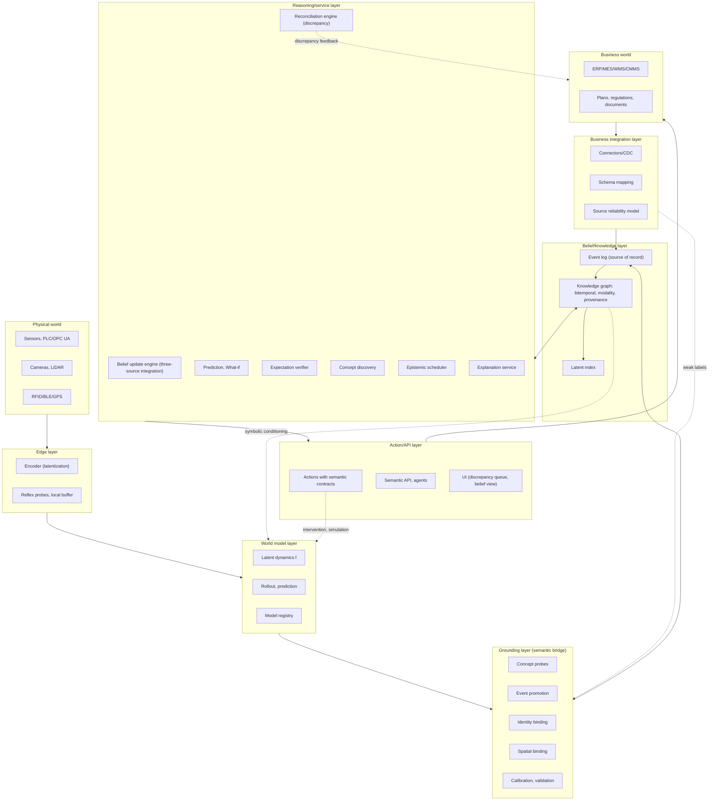
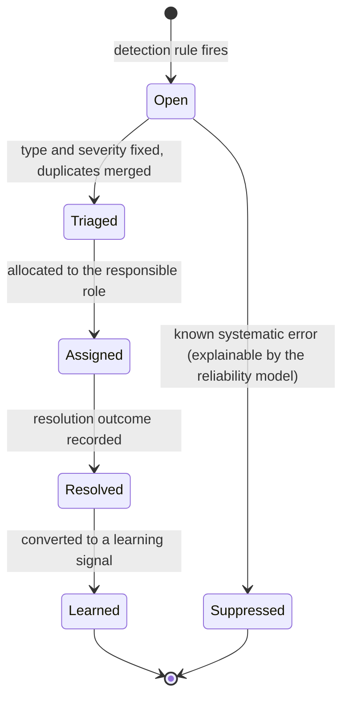
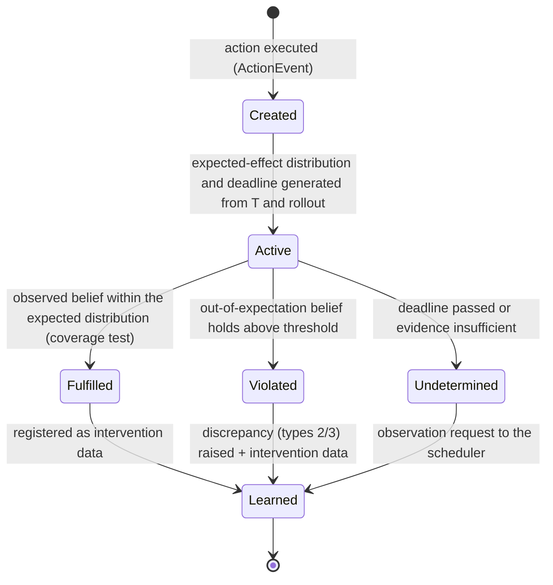
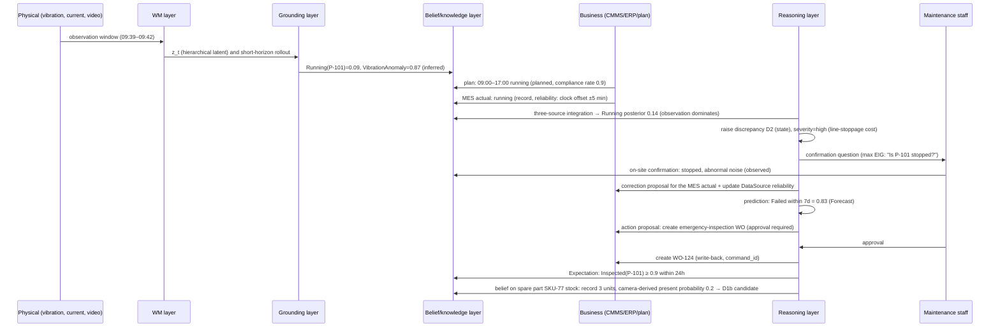

# Physical–Business Semantic Bridge Platform (SBP) Detailed Design

**Semantic Bridge Platform — An Intelligent Data Platform Built on World Model × Ontology** — v0.1 (2026-09-29)

---

## 0. Position of This Document

### 0.1 Purpose and Audience

This document defines the detailed design of an intelligent data platform that combines a world model (WM) with an ontology to connect the physical world (sensors, cameras, equipment, people, objects) and the digital business world (ERP/MES/WMS/CMMS, plans, regulations, documents) semantically. The intended readers are architects, data/ML engineers, ontology owners, and business-side domain owners.

### 0.2 Design Assumptions (Stated Explicitly)

| # | Assumption | Impact if it does not hold |
|---|---|---|
| A1 | At least one kind of continuous observation (time series, video, or position) is acquired continuously on the physical side | The WM layer does not hold. The platform runs on rule-based detectors only (equivalent to Phase 0) |
| A2 | On the business side there exist records carrying IDs that refer to physical entities (asset ID, SKU, lot, work order number) | There is no starting point for identity binding, and reconciliation is limited to "existence discrepancy" |
| A3 | The organization accepts that business records can be wrong (delays, template entries, closing processes) | The platform degrades from a reconciliation tool into a reporting tool |
| A4 | The initial scope is 1 domain and 1–2 sites. Multi-site federation is Phase 3 | If multiple sites are targeted from the start, the co-evolution of the ontology and the WM does not converge |
| A5 | There are areas where people may appear in raw video | Privacy design (edge latentization, non-retention) becomes a mandatory requirement |

### 0.3 Core Theses (The Backbone of the Design)

1. **Manage belief, not truth.** Sensors break, models hallucinate, and records are distorted. The platform is a "belief maintenance system" that maintains, reconciles, and predicts the three information sources (physical observation, business records, plans/norms) as probabilistic beliefs structured by an ontology.
2. **Every fact is someone's claim.** Business records, WM estimates, and predictions are all information content entities (ICE) "about" physical entities; they differ only in provenance and modality.
3. **Grounding is a pair of mappings, not classification.** There are mappings in both directions: symbol → latent region (grounding) and latent trajectory → symbolic event (abstraction). The consistency condition is that their dynamics approximately commute (A∘f ≈ T∘A).
4. **Events first, state as projection.** Both physical and business events are recorded in a semantically typed event log, and state can be recomputed as a projection from it.
5. **Discrepancy is a product, not an exception.** Mismatches between the physical and the business are treated as first-class objects, and their resolution outcomes are turned into learning signals.

---

## 1. Purpose, Scope, and Requirements

### 1.1 Mission

Cross-check "what is happening in the physical world right now," "what the business systems say," and "what should be the case" on the same vocabulary, the same time axis, and the same confidence scale, predict from them, and connect them to action.

### 1.2 Target Domains (Initial Candidates)

| Domain | Physical side | Business side | First discrepancies to target |
|---|---|---|---|
| Manufacturing and equipment maintenance | Vibration, current, temperature, video, PLC state | CMMS work orders, MES operating records, maintenance plans | State discrepancy (running/stopped), unperformed work |
| Warehouse and inventory | Cameras, RFID/BLE, forklift positions | WMS inventory and receipts/issues, ERP orders | Existence discrepancy (phantom inventory, unposted items), identity discrepancy |
| Facilities and energy | BMS measurements, occupancy sensing, power | Production plans, contract demand, regulations | Normative discrepancy (contract overrun), deviation from plan |
| Logistics yard | Vehicle and pallet tracking, gates | Dispatch plans, shipping slips, SLA | Temporal discrepancy, signs of SLA violation |

### 1.3 Functional Requirements

| ID | Requirement | Realizing layer |
|---|---|---|
| FR-01 | Estimate latent state from physical observations and return a predictive distribution for an arbitrary horizon | WM layer |
| FR-02 | Ground the ontology's concepts and attributes in the latent state and symbolize them with calibrated confidence | Grounding layer |
| FR-03 | Bind physical individuals to business IDs with evidence, and be able to retract the binding | Grounding layer |
| FR-04 | Hold all assertions with bitemporal data (valid time and transaction time) plus modality, confidence, and provenance, and answer as-of queries | Belief/knowledge layer |
| FR-05 | Map business-system records, plans, and regulations into a single event model | Business integration layer |
| FR-06 | Maintain a posterior belief that integrates the three sources (observation, records, plans) | Reasoning layer |
| FR-07 | Detect, raise, and track the five types of discrepancy, and feed resolution outcomes back into learning | Reasoning layer |
| FR-08 | Attach semantic contracts (preconditions and expected effects) to actions and verify effects automatically after execution | Action layer |
| FR-09 | Evaluate What-if scenarios for business plans as physical simulations | Reasoning layer + WM layer |
| FR-10 | Re-ground past data after version updates of the ontology, models, and probes | Belief/knowledge layer |
| FR-11 | In response to an explanation request, return a rationale joining the symbolic side (rules, records) and the latent side (probes, observation windows) | Reasoning layer |
| FR-12 | Plan additional observation, confirmation by humans, and record reconciliation based on the value of uncertainty reduction | Reasoning layer |
| FR-13 | Propose candidate concepts from ungrounded latent structure and version-up the ontology after human curation | Reasoning layer + governance |
| FR-14 | Allow LLM agents to read and write beliefs and execute actions within their permissions via the semantic API | API layer |

### 1.4 Non-Functional Requirements

| Category | Requirement |
|---|---|
| Latency tiers | L0 edge reflex: < 100 ms (local safety) / L1 site belief update: < 1 s / L2 reconciliation and ticketing: < 60 s / L3 batch (re-grounding, learning): hours |
| Throughput | Sensor events per site 10⁴–10⁶ /s (10²–10³ /s of latent vectors after latentization), business events 10²–10⁴ /day |
| Availability | Knowledge layer 99.9%; edge/site operate autonomously for 24 h or more even when the network is down (local buffer, local belief) |
| Retention | raw 30–90 days (not retained for areas where people appear), latent 1–2 years, symbolic indefinitely (non-destructive via bitemporality) |
| Auditability | From any assertion, the evidence is reachable within 3 hops; model versions and ontology versions are recoverable |
| Privacy | No taking raw video off site, periodic verification of resistance to reconstruction attacks from latents, access control per concept type |
| Extensibility | New sites can be added without ontology changes; adding new concepts does not break existing probes (additive version updates) |
| Accountability | Approval by a human can be made mandatory for high-impact actions (configurable threshold) |

### 1.5 Out of Scope

The robot control loop itself (the platform supplies state and semantics but does not perform motion planning), replacement of business systems (ERP/MES remain the system of record), and general-purpose LLM chatbots.

### 1.6 Design Principles

| # | Principle | Concrete consequence |
|---|---|---|
| P1 | Belief > truth | No "correct" flag. Everything is confidence and provenance |
| P2 | Bidirectional, dynamic grounding | Probes are not adopted on static classification accuracy alone. Consistency residual is a mandatory metric |
| P3 | Events first | State stores can always be rebuilt from the event log |
| P4 | Do not omit the three temporalities | Every assertion carries valid time, transaction time, and prediction horizon |
| P5 | Discrepancy is a product | Build the closed loop of detect → raise → resolve → learn as a product feature |
| P6 | Minimal ontology, observation-driven growth | Start with 20–30 types initially. Grow it through the concept discovery loop |
| P7 | Symbols also condition latents | Make business context an input to the WM (but isolate the records under audit from the input) |
| P8 | Recomputability | Retain raw/latent/versions so that re-grounding is possible |
| P9 | Outward principle of semantic compression | What leaves a site is latent rather than raw, and symbolic rather than latent |
| P10 | Standards first, own definitions minimal | Adopt standards for upper/observation/provenance/time/space; own definitions are limited to connecting concepts such as Situation and Discrepancy |

---

## 2. Conceptual Model and Overall Architecture

### 2.1 Three Worlds and One Belief

- **Physical world**: continuous, high-dimensional, partially observed, and with inertia. The true state cannot be observed, and the WM estimates it as the latent state z.
- **Symbolic world (business)**: discrete, explicit, assertive. It is recorded as transactions but contains delays and errors.
- **Normative world**: plans (what is scheduled to be done) and regulations/contracts (what ought to be done). It provides priors and constraints.
- **Belief**: a probabilistic state, typed by the ontology, that integrates the three. The only thing the platform "owns."

### 2.2 Terminology

| Term | Definition |
|---|---|
| Latent state z | A continuous vector (with hierarchy and time scales) that the WM estimates from the observation window |
| Probe φ_C / ψ_p | A learner that outputs, from z, the probability that concept C holds / the value distribution of attribute p |
| Abstraction map A | The symbolic state (a set of facts with probabilities) that bundles the outputs of a group of probes |
| Symbolic transition T | A transition of the symbolic state derived from the process ontology (event calculus) |
| Consistency residual | ‖A(f(z,a)) − T(A(z),a)‖. The breaking of commutativity between the WM and the ontology |
| Modality | The status of a fact: observed / inferred / predicted / planned / normative / hypothetical |
| ICE | Information content entity. All of records, observations, predictions, plans, norms, and explanations |
| Situation | A unit bundling a spatiotemporal region + participants + relations + resolution status |
| Discrepancy | A first-class object representing a mismatch between the physical and the business (five types) |
| Expectation | A verification target, generated when an action is executed, with an expected effect and a deadline |
| IdentityClaim | A claim binding a physical track to a business ID (with evidence, confidence, and validity period) |
| Re-grounding | The process of recomputing the symbolic state from latents after a version update |

### 2.3 Overall Architecture



### 2.4 Responsibilities and Non-Responsibilities of Each Layer

| Layer | Responsibilities | Non-responsibilities |
|---|---|---|
| Edge | Time synchronization of observations, latentization, reflex probes for local safety, buffering during disconnection | Fixing meaning, referencing business records |
| WM | Latent state estimation, transition, prediction, intervention simulation | Deciding symbols, applying business rules |
| Grounding | Symbolization, event promotion, identity and spatial binding, calibration, constraint validation | Persisting state, integrating beliefs |
| Belief/knowledge | Event log, knowledge graph with bitemporality, modality, and provenance, latent index, re-grounding | Reasoning logic, UI |
| Business integration | Connectors, mapping, conversion to business events, reliability model, write-back | Replacing business systems |
| Reasoning/service | Three-source integration, reconciliation, prediction, What-if, expectation verification, concept discovery, scheduling, explanation | Data persistence |
| Action/API | Semantic contracts, approval, execution, API, agents, UI | Model training |

### 2.5 The Three Data Paths

1. **Estimation path** (physical → belief): observation → latent z → probe → typed probabilistic event → event log → belief update.
2. **Record path** (business → belief): CDC/API → schema mapping → BusinessEvent (with reliability metadata) → event log → belief update.
3. **Action path** (belief → business/physical): decision → semantic contract validation → approval → execution (write-back / command) → Expectation generation → verification → learning.

---

## 3. Ontology Design

### 3.1 Layer Structure

| Layer | Content | Change frequency | Owner |
|---|---|---|---|
| L0 Upper | BFO (continuant / occurrent / quality / role), IAO (ICE, is_about), PROV-O, OWL-Time, GeoSPARQL, QUDT, SOSA/SSN | Nearly immutable | Platform team |
| L1 SBP core | Situation, Fluent, Modality, Discrepancy, Expectation, IdentityClaim, Track, Anchor, Probe, ModelVersion | A few times a year | Platform team |
| L2 Domain | ISO 15926/CFIHOS, AAS submodels, OPC UA information model, Brick, EPCIS 2.0, SAREF, GS1 | Follows revisions of the standards | Domain owners |
| L3 Enterprise | Object types, link types, action types, function types, enterprise-specific state machines and regulations | Monthly | Business owners |
| L4 Application | Views and derived attributes for screens and agents | Weekly | Application team |

Upper layers adopt standards and avoid custom definitions. Originality is concentrated in the L1 "connecting concepts."

### 3.2 Use of the Upper-Level Categories

- **continuant (enduring entity)**: Asset, MaterialItem, Person, Vehicle, Location. Retains identity through time.
- **occurrent (happening)**: Process (continuing), Event (instantaneous to short duration). The primary objects the WM handles.
- **quality (property)**: temperature, vibration, quantity. Corresponds to SOSA's ObservableProperty.
- **role (role)**: Operator / Inspector that a Person takes on within a Situation. Treated as a role, not a type.
- **ICE (information content entity)**: Observation, Forecast, Record, PlanItem, Norm, Explanation, Assertion. All point to physical entities via `is_about`.

### 3.3 SBP Core Classes

| Class | Upper | Description | Main attributes and relations |
|---|---|---|---|
| PhysicalEntity | continuant | Collective term for entities that exist physically | hasLocation, hasPart, identifiedBy |
| Asset | PhysicalEntity | Equipment, machines | assetId, assetType, lifecycleState |
| MaterialItem | PhysicalEntity | Parts, products, inventory units | sku, lot, quantity(QUDT) |
| Person | PhysicalEntity ∧ Agent | A person (roles are assigned within a Situation) | — (personally identifying attributes are in principle not retained) |
| Carrier | PhysicalEntity | Pallets, containers, vehicles | carrierId |
| UnidentifiedPhysicalObject | PhysicalEntity | A physical individual not yet bound to a business ID | track, firstSeen, lastSeen, appearanceEmbeddingRef |
| Location | continuant | Facilities, buildings, lines, cells, docks, shelves | geometry, coordinateFrame, containedIn |
| Zone | Location | A predicate-defined region (hazard area, storage section) | polygon/volume, zoneType |
| FluentType | ICE(schema) | Type of state predicate (Running, Present, Occupied…) | subjectType, valueDomain, mutuallyExclusiveWith |
| EventType | ICE(schema) | Type of event (StartCmd, Fault, GoodsReceipt…) | initiates, terminates, participantsSchema |
| PhysicalEvent | occurrent | An observed or estimated physical event | subject, interval, evidence |
| BusinessEvent | occurrent | A business transaction | source, recordRef, postingTime |
| ActionEvent | occurrent | An action execution via the platform | action, actor, approvals |
| Process | occurrent | A continuing physical/business process | phases, participants |
| Situation | occurrent | Spatiotemporal region + participants + relations + resolution status | spatialExtent, temporalExtent, hasParticipant, status |
| Observation | ICE(SOSA) | An observation by a sensor or virtual sensor (WM) | madeBySensor, hasResult, resultTime, featureOfInterest |
| Forecast | Observation | A prediction with a horizon | horizonOrigin, leadTime, conditionedOn |
| Record | ICE | A business record (slip, work order, inspection form) | source, recordedAt, reliabilityProfile |
| PlanItem | ICE | A plan/schedule item | plannedInterval, target, adherencePrior |
| Norm | ICE | Regulations, contract clauses, safety rules | ruleRef(Datalog/SHACL), sourceDocument, severity |
| ActionType | ICE(schema) | Type of executable action | preconditions, effects, riskClass, requiredApprovals |
| Expectation | ICE | Expected effect and deadline | action, expectedEffects(dist), deadline, status |
| Discrepancy | ICE | A physical–business mismatch | kind(1..5), subjects, evidence, severity, status, resolution |
| IdentityClaim | ICE | A claim binding a physical track to a business ID | track, entity, evidence, confidence, validInterval |
| Track | ICE | A spatiotemporal track generated by perception | tracklets, frame, embeddingRef |
| Anchor | PhysicalEntity ∧ Sensor | A reference point for identity binding | anchorKind(fixed/mobile/inferential), pose |
| Probe | ICE | Registration of a concept/attribute probe | grounds(concept), wmVersion, metrics, calibration, status |
| WorldModelVersion | ICE | A version of the WM | domain, latentSpec, trainingProvenance |
| OntologyVersion | ICE | An ontology version | semver, changelog, compatibility |
| DataSource | Agent | A business system or group of sensors | reliabilityModel, clockProfile |

### 3.4 Main Relations

| Relation | Domain → Range | Meaning |
|---|---|---|
| is_about | ICE → PhysicalEntity ∨ occurrent | The subject of a claim |
| hasParticipant | Situation ∨ Event → PhysicalEntity | Participant (may be qualified with a role) |
| occursAt / locatedIn | occurrent ∨ PhysicalEntity → Location | Spatial position (derived predicate) |
| holdsAt | (FluentType, PhysicalEntity) → interval | Valid time during which a state holds |
| initiates / terminates | EventType → FluentType | Event calculus rules (with conditions and delay distributions) |
| evidenceFor | ICE → Assertion | Evidence |
| wasDerivedFrom / wasGeneratedBy / wasAttributedTo | PROV-O | Provenance |
| groundedBy | Concept ∨ Property → Probe | Implementation of grounding |
| boundTo | Track → PhysicalEntity (via IdentityClaim) | Identity binding |
| targets / expects | Action → PhysicalEntity / Expectation | The target and expectation of an action |
| concerns | Discrepancy → Assertion ∨ PhysicalEntity | The object of a discrepancy |
| conditionedOn | Forecast → PlanItem ∨ Assertion | The condition of a prediction |
| mutuallyExclusiveWith | FluentType → FluentType | Exclusion constraint (used in validation) |

### 3.5 Belief Metadata (Common to All Assertions)

Every assertion carries the following tuple. In RDF it is implemented as an annotation on the statement (concretely, RDF 1.2 triple terms + `rdf:reifies`. The old RDF-star notation of placing a quoted triple in the subject position cannot be used in the current Oxigraph. See **ADR-0005**). In a property graph it is implemented as edge properties.

| Field | Type | Meaning |
|---|---|---|
| subject / predicate / object | IRI / IRI / IRI∨literal | The claim itself |
| valid_from / valid_to | xsd:dateTime (right-open) | Valid time |
| tx_from / tx_to | xsd:dateTime (right-open) | Transaction time (the period during which the platform believed it) |
| modality | enum | observed / inferred / predicted / planned / normative / hypothetical |
| belief | structure | boolean: p∈[0,1] / categorical: pmf / numeric: (mean, var, quantiles) or a samples reference |
| horizon_origin / lead_time | dateTime / duration | predicted only |
| provenance | IRI (PROV bundle) | Generating activity, agent, model version, evidence set |
| source_reliability | IRI | The reliability model applied |
| situation | IRI | The Situation it belongs to (optional) |
| scenario | IRI | hypothetical only. What-if scenario identifier |

Modality is treated as a lattice: observed < inferred < predicted < planned (an order of "factuality status," not of likelihood); normative is orthogonal; hypothetical is isolated unless promoted to the main belief graph.

### 3.6 Time Model

- **Three temporalities**: valid time (the period during which it actually was so), transaction time (the period during which the platform believed it so), and prediction horizon (the origin and lead time of predicted).
- **Two clocks**: the physical clock (PTP/NTP synchronized; both the edge reception time and the sensor time are retained) and the business clock (slip date, posting date, closing).
- **Tolerance profile**: each DataSource has a distribution of clock offsets (e.g., MES ±5 min, ERP goods receipt within the same day, handwritten daily report ±1 shift). The decision thresholds for temporal discrepancy (type 3) are derived from this.
- **Interval algebra**: Allen's 13 relations are used for comparing holdsAt / occursDuring.

### 3.7 Spatial Model

- A **facility coordinate system** (origin, axes, units) is defined for each facility, and outdoors a transformation to a geodetic system is provided.
- A Zone is a polygon/volume in the facility coordinate system. `locatedIn` is a probabilistic predicate derived from the position distribution (mean, covariance) and the containment probability of the Zone.
- Cameras and readers have extrinsic parameters (pose) as Anchors, and transform perception output into the facility coordinate system.

### 3.8 Process Ontology (Event Calculus)

The initiates / terminates rules between FluentType and EventType are described with conditions and delay distributions.

```text
FluentType Running(a: Asset)
FluentType UnderMaintenance(a: Asset)   mutuallyExclusiveWith Running
EventType  StartCmd(a), StopCmd(a), MaintStart(a), MaintEnd(a), Fault(a)

Initiates(StartCmd(a), Running(a))     if not UnderMaintenance(a)   delay ~ LogNormal(μ=ln 30s, σ=0.5)
Terminates(StopCmd(a), Running(a))                                   delay ~ LogNormal(μ=ln 10s, σ=0.4)
Terminates(Fault(a), Running(a))                                     delay ~ Exponential(1/5s)
Initiates(MaintStart(a), UnderMaintenance(a))
Terminates(MaintEnd(a), UnderMaintenance(a))
```

This description is compiled in three ways: (1) the symbolic transition T (for computing the consistency residual; Datalog/ASP), (2) the transition prior of the belief update engine (semi-Markov dwell times), and (3) the inverse mapping of event promotion (inferring, from a change in a fluent, the event type that must have occurred).

### 3.9 Constraints and Reasoning

- **Structural constraints (SHACL, Violation)**: an Asset must have a Location, an IdentityClaim must have a Track and an Entity, and so on. Violations do not reject registration to the event log; they are routed to a "quarantine queue."
- **Consistency constraints (SHACL, Warning)**: if exclusive fluents both hold with confidence > 0.5 over the same valid time, generate a discrepancy candidate. **Validation is designed as evidence generation, not rejection.**
- **Reasoning**: OWL RL-equivalent type inference, and derived predicates via Datalog (containment transitivity of locatedIn, part–whole aggregation, normative violation determination). Closed-world is declared only for individual predicates (open-world by default).

### 3.10 Enterprise Layer: Objects, Links, Actions, Functions

| Type | Corresponds to | Example |
|---|---|---|
| ObjectType | A business-facing view of L1/L2 classes | Pump (subtype of Asset), WorkOrder (subtype of Record) |
| LinkType | A view of relations | WorkOrder → targets → Pump |
| ActionType | Actions with semantic contracts | CreateWorkOrder, ReleaseProductionOrder, AdjustInventory |
| FunctionType | Derived attributes (implemented by rules, probes, prediction queries) | predictedFailureWithin7d (Forecast query), physicallyPresent (belief query) |

Because FunctionType is backed by WM predictions and beliefs, business-side screens and APIs can handle "physically grounded attributes" in the same way as ordinary attributes.

### 3.11 Adoption Mapping of Standards

| Purpose | Standard | Usage |
|---|---|---|
| Upper-level categories | BFO 2020 | Backbone of continuant/occurrent/quality/role |
| Claims and their objects | IAO | ICE and is_about |
| Observations, virtual sensors | SOSA/SSN | Unified description of sensor values, WM estimates, and predictions |
| Provenance | PROV-O | Chains of activities, agents, and derivations |
| Time, space, units | OWL-Time / GeoSPARQL / QUDT | Intervals, geometry, quantities with units |
| Industrial assets | ISO 15926, CFIHOS, AAS, OPC UA | Equipment classification, attribute dictionaries, information models |
| Buildings | Brick | Relations between spaces and equipment |
| Supply-chain events | EPCIS 2.0 | Common frame for what/when/where/why/how events |
| IoT | SAREF | Devices and functions |
| Usage-purpose constraints | ODRL | Data usage policies |

### 3.12 Conventions for IDs, Naming, and Versioning

- IRI namespaces: `sbp-core:` (L1), `dom-*:` (L2), `ent:` (enterprise), `site-<id>:` (site individuals).
- Event IDs are UUIDv7 (time-ordered); entity IDs are stable IRIs derived from business IDs plus an internal surrogate.
- Ontology versions follow semver: MAJOR = deletion of or semantic change to a class/relation, MINOR = additive changes, PATCH = annotations. Up to MINOR, CI verifies that existing probes and queries are not broken.
- Deprecation requires a grace period of at least 2 MINOR versions, and `owl:deprecated` and a designated successor are mandatory.

---


## 4. World Model Layer Design

### 4.1 Responsibilities

Estimate the latent state z from an observation window, learn a transition f conditioned on actions and context, and return rollouts over an arbitrary horizon as distributions. It does not decide symbols (that is the responsibility of the grounding layer).

### 4.2 Model Family Selection

| Physical domain | Recommended family | Nature of the latent | Rationale | Caveats |
|---|---|---|---|---|
| Video and space (warehouses, yards, lines) | JEPA-style latent prediction models + 3D scene representations (occupancy, splatting) | High-dimensional; implicitly retains geometry | Avoids pixel reconstruction and is robust to lighting and noise. Probes are often fine as linear | Generative video WMs are limited to visualization and synthetic-data uses |
| Equipment and processes (rotating machinery, reactors) | Koopman operator models, Neural ODE / PINN, RSSM | Linearized transitions, embedded physical laws | Koopman eigenfunctions map easily onto fluents, and alignment residuals are easy to interpret | Non-stationary operation requires switching operators (modes) |
| Networks (logistics, power, piping) | GNN simulators | Node/edge latents | The ontology's part-whole and connectivity structure can be used directly as input | Compute cost is proportional to the number of edges |
| People and flows | Agent-based + learned correction | Individual latents + field | Strong for What-if on interventions (changing routes) | Aggregated design to avoid identifying individuals |
| General multivariate time series | State-space models / Transformer family | General-purpose | Baseline | Tends to diverge over long horizons |

### 4.3 Common Interface

```text
interface WorldModel {
  meta: { id, version, domain, modalities[], latentSpec{dims, levels, timescales}, trainingProvenance }

  encode(obsWindow, context?)              -> LatentState   // z and uncertainty (covariance or ensemble)
  step(z, action?, context?)               -> LatentState
  rollout(z, actionSeqOrPolicy, horizon, nSamples, context?) -> Trajectory[]   // sampled trajectories
  probe(z, probeIds[])                     -> { probeId: Distribution }
  explain(z, probeId)                      -> Attribution   // attribution to input modalities, time windows, latent dimensions
  embed(z, level)                          -> Vector        // for the latent index
  health()                                 -> { latentShift, predError, alignResidual }
}
```

`context` is the symbolic conditioning vector (§4.4). `action` is an ontology ActionType instance mapped into WM input (the intervention encoder).

- **Interface as implemented (ADR-0007)**: `WorldModel` consists of `encode / step / rollout / embed / health / attribute` and has no `probe` or `explain`. Taking a probe ID as an argument would make the WM aware of grounding-layer types, which violates both the layer dependency (`worldmodel ← bridge`) and "the WM does not decide symbols" (§4.1). Attribution is `attribute(state, weights) -> Attribution` (`weights` are the coefficients of a linear functional; a linear probe's weights go in as they are). Applying probes is done by the grounding layer, and assembling explanations by the explanation service (§8.8). The amount of information in the explanation as seen by the user does not change. The alignment residual in `health()` is passed in by the caller (if it is not passed, it is 0, which makes visible that it was "not evaluated").

### 4.4 Latent State Design

- **Hierarchical latents**: L-fast (ms to s: sensor behavior), L-mid (minutes: equipment state), L-slow (hours to days: degradation, inventory level). Each level has its own set of probes, kept consistent by part-whole aggregation constraints.
- **Symbolic conditioning**: Embed the k-hop neighborhood of the ontology instance graph (types, current beliefs, PlanItem, Norm) with a GNN and feed it to f as `context`.
- **Audit isolation**: Do not feed a record itself (or beliefs derived from it) into the estimation used to audit that record. The conditioning vector is generated with an "audit-target mask" applied.
- **Uncertainty**: Ensemble (3 to 5) or latent Gaussian. Probes receive distributions and propagate them to the output distribution.

### 4.5 Training Pipeline

| Stage | Data | Purpose | Gate |
|---|---|---|---|
| 1. Self-supervised pretraining | raw/latent streams | Latent prediction (JEPA-style), physical-law loss | Prediction error, latent collapse metrics |
| 2. Symbolic conditioning training | 1 + instance graph | Context-dependent transitions | Conditional prediction improvement |
| 3. Weakly supervised probe training | Weak labels derived from business records (§5.2) | φ_C, ψ_p | AUROC, MIL consistency |
| 4. Logical constraint injection | Ontology constraints | Suppress violations of exclusion and implication | Constraint violation rate |
| 5. Alignment training | Process ontology T | Minimize the homomorphism residual | Residual distribution |
| 6. Calibration | Held-out data | Temperature scaling, conformal | ECE, coverage |
| 7. Active learning | Uncertain and discrepant locations | Label efficiency | Learning curve |

### 4.6 Loss Composition

```text
L = L_pred(latent prediction)
  + λ_phys · L_phys(physical laws, conserved quantities)
  + λ_probe · L_probe(weak labels; multiple-instance loss per temporal bag)
  + λ_logic · L_logic(t-norm relaxation of constraints; Logic Tensor Networks / semantic loss)
  + λ_align · Σ_(z,a) ‖A(f(z,a)) − T(A(z),a)‖²
```

Schedule λ per stage, and strengthen the alignment loss in the later stages (if it is strong from the start, the latent overfits to the symbols).

### 4.7 Inference Placement and Latency Tiers

| Tier | Placement | Content | Target |
|---|---|---|---|
| L0 | Edge | Encoder, reflex probes (hazard-zone intrusion, etc.) | < 100 ms |
| L1 | Site | Transitions and short-horizon prediction, all probes, event promotion | < 1 s |
| L2 | Site/central | Long-horizon rollouts, What-if | Seconds to minutes |
| L3 | Central | Training, re-grounding, drift analysis | Hours |

When the network is down, a site continues L0/L1, accumulates events in a local log, and synchronizes them with ordering guarantees after recovery.

### 4.8 Registry, Versions, Drift

- The registry registers WorldModelVersion in the ontology and holds the probes and a compatibility matrix.
- Drift monitoring: latent distribution shift (MMD / PSI), trend of prediction error, trend of alignment residual, degradation of probe calibration. When a threshold is exceeded, trigger shadow evaluation, then retraining.
- Promotion goes through a canary (some sites, some concepts), then to everything. Estimates from old versions remain in transaction time.

---

## 5. Grounding Layer (Semantic Bridge) Design

### 5.1 Components

| Component | Input | Output |
|---|---|---|
| Concept probe | z (distribution) | Concept-holds probability, attribute value distribution |
| Event promotion | Time series of probe outputs | PhysicalEvent (interval, confidence, inferred event type) |
| Identity binding | Track, Anchor observations, business context | IdentityClaim / UnidentifiedPhysicalObject |
| Spatial binding | Position distribution, Zone | locatedIn probability |
| Calibration | Raw probe output | Calibrated probability, prediction set |
| Verification | Typed events, constraints | Quarantine / warning / discrepancy candidate |

### 5.2 Concept Probe Specification

- **Kinds**: classification (φ_C: Z→[0,1]), regression (ψ_p: Z→Dist(V_p)), detection (spatiotemporal localization).
- **Implementation policy**: Start with linear probes (which double as a quality check of the latent), and use a small head only when that is insufficient. A concept that needs non-linearity is routed to WM improvement candidates as a signal that "the latent cannot linearly separate the concept".
- **Weak label generation**: Record → (concept, entity, temporal bag) triples. Example: "WO-123 bearing replacement completed 9/12" → (UnderMaintenance, P-101, [9/12 08:00, 9/12 17:00]) is a positive bag. Train under the multiple-instance assumption that the concept holds in at least one interval within the bag.
- **Label weights**: Derived from the DataSource reliability model (§7.3).
- **Registration metadata**: probe_id, the IRI of the concept it grounds, the corresponding WM version, training-data provenance, evaluation metrics (AUROC/ECE/alignment residual), calibration parameters, valid domain (site, operating mode), and status (candidate / active / deprecated).
- **Adoption criteria**: AUROC ≥ 0.85 and ECE ≤ 0.05 and alignment residual at or below the median of existing probes. The AND of all three conditions.

### 5.3 Event Promotion

1. Apply online change-point detection (Bayesian online change-point or CUSUM) to the probe output sequence to obtain candidate fluent changes.
2. Remove momentary flicker with hysteresis (rising 0.7 / falling 0.3) and a minimum duration.
3. Estimate "the event type that must have occurred" through the inverse mapping of the process ontology (if Running goes from true to false, it is StopCmd or Fault; they are distinguished by the likelihoods of other probes (sudden vibration change) and business context (a record of a stop command)).
4. Assign a validity interval (change point ± uncertainty width) and a confidence, and suppress duplicates against existing events (same entity, same type, overlapping interval).
5. Emit it to the event log as a TypedProbabilisticEvent.

### 5.4 Identity Binding

- **Track**: A spatiotemporal trajectory generated by perception plus an appearance embedding. A Track first exists in the knowledge layer as an UnidentifiedPhysicalObject (so that things the business does not know about can be represented).
- **Anchor kinds**: fixed (calibrated cameras, gates, RFID/BLE readers), portable (tags), and inferred (spatiotemporal continuity + business context: "the pallet that just left dock 3 is shipment #123 according to the dispatch plan").
- **Binding algorithm**: An assignment problem between the set of Tracks and the set of candidate entities. Cost = −log P(match | appearance similarity, spatiotemporal consistency, business prior). Use the Hungarian method for small scale, and JPDA/MHT when multiple hypotheses are needed.
- **IdentityClaim**: Has confidence, evidence, and a validity interval. It is recomputed on new evidence, and if it falls below the threshold it is withdrawn and a discrepancy of type 4 is raised.
- **Prohibition**: A Person's Track is not used for individual identification (only role, head count, and position).

### 5.5 Spatial Binding

Compute inclusion probability from the position distribution N(μ, Σ) and the Zone geometry, and output `locatedIn` as a probabilistic predicate. The hierarchy (shelf → section → building) is derived by containment transitivity.

### 5.6 Calibration and Uncertainty

- Classification: temperature scaling plus periodic audits of reliability diagrams.
- Regression: prediction intervals via conformal prediction, with coverage monitored.
- Ensemble variance is kept as "epistemic uncertainty" and the calibrated distribution as "aleatoric uncertainty", held separately; the scheduler (§8.7) targets epistemic uncertainty.

### 5.7 Verification and Promotion Policy

| Condition | Action |
|---|---|
| Structural constraint violation | Quarantine queue (not registered; a human reviews) |
| Exclusive fluent collision | Register both and generate a discrepancy candidate (type 2) |
| Confidence < 0.3 | Register, but treat as weak (weighted) when used as a likelihood in belief updates |
| Alignment residual > threshold | Register and notify drift monitoring |

### 5.8 Output Contract (TypedProbabilisticEvent)

```json
{
  "event_id": "018f5c7e-...-7f3a",
  "schema_version": "1.2",
  "type": "sbp-core:PhysicalEvent/ent:PumpStopped",
  "subject": "site-A:asset/P-101",
  "valid_time": { "start": "2026-09-12T09:41:30Z", "end": "2026-09-12T09:42:10Z", "uncertainty_s": 20 },
  "tx_time": "2026-09-12T09:42:12Z",
  "modality": "inferred",
  "belief": { "kind": "boolean", "p": 0.91 },
  "inferred_event_type": { "ent:StopCmd": 0.35, "ent:Fault": 0.56, "other": 0.09 },
  "evidence": [
    { "kind": "probe", "probe_id": "probe:running-v7", "wm_version": "wm:pump-koopman-3.2", "window": ["2026-09-12T09:39:00Z", "2026-09-12T09:42:00Z"] },
    { "kind": "probe", "probe_id": "probe:vibration-anomaly-v3", "p": 0.87 }
  ],
  "producer": { "agent": "bridge@site-A", "version": "2.4.1" },
  "situation": "site-A:sit/2026-09-12/line3-shift1",
  "alignment_residual": 0.08
}
```

---

## 6. Belief and Knowledge Layer Design

### 6.1 Event Log (System of Record for Events)

- **Topic design**: `<site>.<layer>.<eventClass>` (e.g. `siteA.bridge.physical`, `siteA.integration.business`, `central.reasoning.discrepancy`). The partition key is the subject entity IRI (ordering guarantee per entity).
- **Envelope**: event_id (UUIDv7), schema_version, type, subject, valid_time, tx_time, modality, belief, evidence, producer, causation_id (originating event), correlation_id (Situation).
- **Idempotency**: Deduplication by event_id. Events originating from write-backs retain a command_id so that they survive retransmission.
- **Ordering**: Monotonic per entity. Across sites, align by tx_time and causal IDs (a global order is not required).
- **Schema registry**: JSON Schema is generated from the ontology's EventType, with compatibility checks (only backward compatibility is allowed).
- **Retention and compaction**: Indefinite. Periodic snapshots (of belief state) keep reconstruction time down.

### 6.2 Three-Tier Storage

| Tier | Content | Store | Retention | Use |
|---|---|---|---|---|
| raw (cold) | Raw sensor values, video (not retained for areas where people appear) | Object store (encrypted) | 30 to 90 days | Re-latentization, audit |
| latent (warm) | Hierarchical latents z, Track embeddings | Columnar (entity × time × level) | 1 to 2 years | Re-grounding, similarity search, training |
| symbolic (hot) | Events, assertions, objects | Graph + event log | Indefinite | Query, reasoning, UI |

On a version update, "re-ground from latent" is the default, and re-latentization from raw is done only on a MAJOR update of the WM.

### 6.3 Physical Design of the Knowledge Graph

| Aspect | RDF/OWL/SHACL (RDF-star) | Property graph |
|---|---|---|
| Standards compliance, vocabulary reuse | ◎ | △ (mapping required) |
| Statement-level metadata | ◎ RDF-star | ○ Edge properties (attachable only to edges) |
| Inference | ◎ OWL RL / SHACL rules | △ External engine |
| Developer experience, performance | ○ | ◎ |
| Decision | **Primary store** (prioritizing standardization, provenance, inference) | Derived view (can be generated as an application-facing projection) |

- **Named graph strategy**: Partition by `<modality>/<site>/<ontologyVersion>`. hypothetical is isolated in a named graph per scenario.
- **Notation for statement metadata**: Per ADR-0005, use the form `<assertion/{id}> rdf:reifies <<( s p o )>> ; sbp:txFrom ...`.
  The notation in the §6.6 query examples that places `<< s p o >>` in subject position is read as `?a rdf:reifies <<( ?s ?p ?o )>>` in the current implementation.
- **Indexes**: (subject, predicate, valid_from) / (predicate, modality, tx_from) / (situation). For time-range queries, keep an auxiliary index with valid_time converted to numbers.
- **Partitioning**: By site and by year. The central instance federates the site graphs.

### 6.4 Bitemporal Implementation

- Corrections to assertions do not overwrite: close the old statement's tx_to and open the new statement at tx_from (non-destructive).
- An "as-of T" query sees only statements with tx_from ≤ T < tx_to. "valid-at t" means valid_from ≤ t < valid_to.
- A prediction carries horizon_origin and lead_time, and multiple predictions (from different origins) coexist for the same subject and the same valid time. The latest origin is the default, and the full history is used for tracking prediction accuracy (error by origin).

### 6.5 Latent Index and Hybrid Queries

- Shard the ANN index (HNSW) by (entity type, site, level). The key is (entity, time, level).
- The query planner pushes graph predicates down first as filters and then runs the nearest-neighbor search on the remaining candidates (or the reverse, decided by selectivity).
- Keep Situation-level embeddings (aggregations of participant latents) in a separate index to enable "similar situation" search.

### 6.6 Query Language Extensions

On top of SPARQL 1.1 + RDF-star, provide extension predicates for time, modality, and similarity as SERVICEs.

```sparql
PREFIX sbp: <https://sbp.example/core#>
PREFIX ent: <https://sbp.example/ent#>
SELECT ?pump ?p ?lead WHERE {
  ?pump a ent:Pump .
  << ?pump sbp:hasState ent:Failed >> sbp:modality sbp:Predicted ;
                                       sbp:leadTime ?lead ;
                                       sbp:confidence ?p ;
                                       sbp:horizonOrigin ?t0 .
  FILTER (?lead <= "P7D"^^xsd:duration && ?p >= 0.8)
  FILTER NOT EXISTS {
    ?wo a ent:WorkOrder ; ent:targets ?pump ; ent:status ent:Open .
  }
}
```

```sparql
# Combining as-of with similarity search: among the situations believed as of 9/12, those that resemble the current situation and led to an SLA violation
SELECT ?sit WHERE {
  SERVICE sbp:asOf { sbp:txTime "2026-09-12T18:00:00Z"^^xsd:dateTime }
  SERVICE sbp:latent { ?sit sbp:similarTo site-A:sit/current ; sbp:k 20 }
  ?sit a sbp:Situation ; sbp:status sbp:Resolved .
  << ?sit sbp:violates ent:SLA-Delivery-24h >> sbp:confidence ?c .
  FILTER (?c >= 0.7)
}
```

### 6.7 Provenance Design

- PROV Activity: probe-run, rule-run, belief-update, reconciliation, llm-extraction, human-review, regrounding.
- PROV Agent: WorldModelVersion, Probe, Person (can be anonymized by role IRI), DataSource, LLM version.
- Cost control: statement-level provenance is grouped into "bundles", and the evidence set is held by reference. The explanation service expands it when needed.

### 6.8 Re-grounding Job

1. Trigger: promotion of an OntologyVersion / Probe / WorldModelVersion, or a request for retroactive investigation of a discrepancy.
2. Scope selection: compute the affected concepts, entity types, and periods from the dependency graph, and estimate the cost (amount of latent scanning).
3. Execution: scan the latent tier and recompute A with the new version. Add new assertions at a new tx_from (for the old version, only close tx_to).
4. Diff report: list the statements whose confidence changed by at least the threshold and the discrepancies that appeared or disappeared, and pass them to human review.

---

## 7. Business Integration Layer Design

### 7.1 Connectors

| Kind | Method | Examples |
|---|---|---|
| Transactions | CDC (log-based), API polling | ERP vouchers, MES results, WMS receipts and shipments, CMMS work orders |
| Plans | API / files | Production plans, dispatch plans, maintenance plans |
| Rules, contracts, documents | Document ingestion + LLM extraction | Safety regulations, SLA clauses, SOPs |
| Master data | Periodic sync | Asset register, SKUs, site layouts |

### 7.2 Schema Mapping (Functorial Data Migration)

- Regard the business system's schema as a category S and the ontology as a category O, and define a mapping F: S→O. Data migration is expressed with Σ_F (push-forward from business to ontology, join and union) and Δ_F (pulling questions on the ontology side back to the business side).
- The implementation is a minimal mapping DSL (`mappings/*.yaml`; **ADR-0006**, because a Python RML processor
  conflicts in dependencies with pyoxigraph 0.5). For each mapping, CI checks preservation of keys, preservation of required constraints, and preservation of multiplicity.
  The idea of functorial data migration (checking the three preservations as mapping invariants) is retained; only the means of implementation changed.
- Changes to the business-side schema (adding columns, changing semantics) are detected as violations of mapping invariants, and the mapping version is incremented.

### 7.3 Business Eventization and the Source Reliability Model

- Convert each transaction into a BusinessEvent and retain it as a Record (ICE). `is_about` points to the subject entity.
- **Reliability model** (per DataSource × record type):
  - Time-offset distribution (recorded time − actual time of occurrence)
  - Error rate and omission rate
  - Systematic errors (quantity rounding, month-end batch posting, template copying)
  - The form of the likelihood function P(record = x | true state s) (confusion matrix or continuous error distribution)
- Parameters start from initial values set by interviewing the responsible staff, and are continuously estimated from resolved discrepancies (§8.2).

### 7.4 Ingesting Plans and Norms

- PlanItem → an assertion with modality planned (valid time = the planned interval, confidence = the prior distribution of the compliance rate for that kind of plan).
- Norm → Datalog/SHACL rules. The source of each clause (document, section) is retained as provenance. The result of applying a rule is a violation assertion with modality normative.

### 7.5 LLM Extraction from Unstructured Documents

- Structured extraction guided by the ontology's schema (classes, relations, permitted values). Output carries evidence spans (positions within the document).
- Extraction results have modality inferred and provenance llm-extraction (model version, prompt version). They are validated against ontology constraints, and human review is mandatory for high-impact ones (norms, contracts).
- LLM output is never made observed.

### 7.6 Write-back

- Commands are idempotent (command_id). The business system's response is ingested as a BusinessEvent and linked to the action's ActionEvent by causal ID.
- On failure, compensating actions (cancel, send back) are defined in the ActionType in advance.
- Write-back authority is controlled by ABAC per action type (§11).

---

## 8. Inference and Service Layer Design

### 8.1 Belief Update Engine (Three-Source Bayesian Integration)

**State**: the set of fluents per entity, s_t (typed by the ontology). Relations (part–whole, connection) become coupling factors between entities.

**Factors**

| Factor | Origin | Form |
|---|---|---|
| Transition P(s_t \| s_{t−1}, a, plan) | Process ontology T + dwell-time distribution, PlanItem compliance rate | Semi-Markov |
| Observation likelihood P(probe \| s) | Calibrated probe (soft evidence) | Likelihood ratio |
| Record likelihood P(record \| s, source) | Reliability model | Confusion matrix / error distribution |
| Relational constraints | Aggregation (component state → equipment state), exclusion | Factor potential |

**Inference**

- The chain within a single entity uses forward filtering (HMM / semi-Markov).
- Coupling between entities runs message passing along relations (loopy BP) at a fixed period. At large scale, coupling is limited to "strong relations" (part–whole, same Situation).
- Numeric fluents use a particle filter (few particles) or a Gaussian approximation.

```text
procedure update_belief(entity e, events E_t, records R_t, plan P_t):
  prior   ← transition(belief[e], actions(E_t), P_t)        # T, dwell time, plan compliance rate
  for ev in E_t where ev.modality ∈ {observed, inferred}:
      prior ← prior ⊙ likelihood_probe(ev)                   # calibrated likelihood ratio
  for r in R_t:
      prior ← prior ⊙ likelihood_record(r, reliability[r.source, r.type])
  posterior ← normalize(prior)
  for rel in strong_relations(e):
      send_message(rel, posterior)                           # to the next period's message passing
  emit assertions(posterior, modality=inferred, provenance=bundle(E_t, R_t, P_t))
```

**Output**: a set of assertions with modality inferred (belief = posterior). Which of plan, record, and observation dominated the posterior is kept in the provenance and used for explanation.

### 8.2 Reconciliation Engine (Discrepancies)

**Detection rules (five types)**

| Type | Rule (outline) | Main parameters |
|---|---|---|
| 1 Existence | (a) P(present(x, L)) ≥ θ_1 persists for at least τ ∧ no x@L in the records / (b) record x@L ∧ P(present) ≤ 1−θ_1 persists for at least τ | θ_1=0.8, τ=source-dependent |
| 2 State | Divergence between the observation-derived posterior and the record-derived likelihood, JS(p_obs ‖ p_rec) ≥ θ_2, persists for at least τ | θ_2=0.5 |
| 3 Time | \|t_observed − t_recorded\| > 95th percentile of the tolerance profile, or an ordering-constraint violation | Clock profile |
| 4 Identity | IdentityClaim retraction, conflicting claims (multiple entities for one Track, multiple Tracks for one entity) | Threshold 0.5 |
| 5 Normative | A Norm rule is violated on a belief with belief ≥ θ_5 | θ_5=0.7 |

**Severity**: severity = f(business value v(x), belief, duration, normative weight). v is set per ObjectType (asset value, safety grade, SLA penalty).

**Lifecycle**



**Resolution outcome → learning signal**

| Resolution outcome | Handling |
|---|---|
| Physical world is correct | Correct the record (write-back proposal), update the DataSource reliability model (error rate, clock offset) |
| Record is correct | Generate negative-example bags as a probe/WM error, send to the active-learning queue |
| Both wrong | Ontology-gap candidate (§8.6), preserve the Situation |
| Undeterminable | Request additional observation from the epistemic scheduler |

**Duplicate merging**: discrepancies with the same entity, same type, and overlapping intervals are bundled into one, and evidence is added. Suppression rules are limited to "systematic errors explainable by the reliability model" (e.g., a time discrepancy caused by month-end batch posting), and suppression is also recorded in the provenance.

### 8.3 Prediction Service

- Horizons: short (minutes), medium (hours to days), long (weeks). Corresponds to the hierarchical latent.
- Output: stored as a SOSA Forecast (horizon_origin, lead_time, conditionedOn).
- Accuracy tracking: CRPS / interval coverage are recorded per origin, and the "reliable lead time" for each horizon is published.
- Conditioning: PlanItem and the current belief (symbolic conditioning). A plan change triggers re-prediction.

### 8.4 Simulation and What-if

- **Intervention**: an ActionType instance is converted into WM input by the intervention encoder and a rollout is executed. Results are stored in a scenario graph with hypothetical modality.
- **Business What-if**: alternative plans (pulling orders forward, deferring maintenance) are given as PlanItem diffs, and a symbolically conditioned rollout returns the physical effects (power peak, utilization, inventory level) as distributions.
- **Counterfactual**: for a resolved Situation, swap the intervention and run a rollout (causal validity depends on the amount of intervention data from §8.5, so a validity score is attached).
- Promotion of a scenario into the main belief happens only through an explicit operation (a plan adopted as a decision is promoted to planned).

### 8.5 Expectation Object Verifier



- An expected effect is a set of "fluent × deadline × distribution". Judgment uses predictive-interval coverage (conformal) or a Bayes factor.
- The verification result is also a measured value of the consistency residual; whether the WM or the process ontology went wrong is isolated by verifying the symbolic-side expectation (from T) and the latent-side expectation (from the rollout) separately.

### 8.6 Concept Discovery Loop

1. **Detection**: (a) regions where latent density is high but the probes' maximum activation is low, (b) regions where the consistency residual persists, (c) discrepancies whose resolution is repeatedly done by humans (with free-text notes).
2. **Clustering**: density clustering on the latent index. Extract representative cases (for areas where people appear, only feature representations are shown).
3. **Proposal**: give an LLM the symbolic context of the representative cases (surrounding beliefs, Situations, free-text notes) and have it generate the candidate concept's name, definition, superconcept, exclusion/implication with existing concepts, and the expected initiates/terminates rules.
4. **Curation**: the concept owner accepts, rejects, or revises. On acceptance, an OntologyVersion is raised as a MINOR version.
5. **Grounding**: train a probe for the candidate concept (using cluster membership as weak labels) and review it against the adoption criteria (§5.2).
6. **Re-grounding**: apply it to past latents and retroactively add facts.
7. **Deprecation**: probes that have not fired for a set period and concepts that are not used become deprecation candidates.

### 8.7 Epistemic Scheduler

- **Candidate queries q**: changing a sensor's sampling rate, pointing a PTZ camera, temporarily deploying an additional sensor, asking a person a confirmation question, re-reconciling records, partial inventory count.
- **Utility**: U(q) = Σ_x v(x) · EIG_q(x) − c(q). EIG is the expected reduction in epistemic uncertainty of decision-relevant fluents (estimated by sampling from the prior predictive distribution).
- **Constraints**: upper limit on question frequency to humans, sensor bandwidth, safety (PTZ monitoring duty).
- **Selection**: batch selection by greedy + submodular approximation. Execution results return with observed modality and flow into belief update.

```text
procedure schedule(budget):
  cands ← generate_queries(open_discrepancies, undetermined_expectations, high_entropy_fluents)
  for q in cands: q.utility ← Σ_x v(x)·EIG(q, x) − cost(q)
  chosen ← greedy_submodular(cands, budget, constraints)
  dispatch(chosen)   # execution results go to the event log (modality=observed)
```

### 8.8 Explanation Service

- Input: an assertion IRI (or a discrepancy or expectation).
- Output: explanation graph = (symbolic side: applied rules, referenced records, plan) ∪ (latent side: contributing probes, observation window, attribution). Includes the contribution share of which of the three sources dominated the posterior.
- With an as-of specification, the "explanation at that time" can be reconstructed (old-version models and rules are resolved from the provenance).

### 8.9 Rule Engine

Datalog (derived predicates, normative judgment, aggregation) and SHACL rules (shape-based inference) are used together, and the source of each rule (Norm) is kept in the provenance. Because rules execute on beliefs, the belief propagation rule (minimum / product / noisy-OR) is declared per rule.

---

## 9. Action Foundation and Semantic Contracts

### 9.1 ActionType Definition

```yaml
ActionType: ent:CreateEmergencyInspection
  targets: ent:Pump
  preconditions:
    symbolic:  [ "NOT EXISTS open WorkOrder targeting ?pump with type Inspection" ]
    physical:  [ "P(Accessible(?pump)) >= 0.8", "P(UnderMaintenance(?pump)) <= 0.2" ]
    normative: [ "Norm:LOTO applies if Running(?pump)" ]
  effects:
    business:  [ "WorkOrder(type=Inspection, status=Open) created within PT5M" ]
    physical:  [ "P(Inspected(?pump)) >= 0.9 within PT24H" ]
  riskClass: medium
  approvals: { required_if: "severity >= high", role: "maintenance-lead" }
  compensation: ent:CancelWorkOrder
```

### 9.2 Execution Flow

1. Precondition verification: symbolic (SHACL/Datalog), physical (belief query), normative (Norm rules).
2. Approval: require human approval according to riskClass and severity.
3. Execution: write-back (idempotent) or command. Emit an ActionEvent.
4. Expectation generation: create the expected distribution and deadline from effects and rollout.
5. Verification (§8.5) → learning.

### 9.3 Safety Guards

- If physical feasibility is below the threshold, execution is not allowed (a human can override; the override is recorded in the provenance).
- Actions via an agent always require approval when riskClass ≥ medium.
- Repeated actions on the same target within a short time are rate-limited.

---

## 10. API, Agents, and UI

### 10.1 Semantic API

| Form | Purpose |
|---|---|
| GraphQL over ontology | Exposes ObjectType/LinkType/FunctionType as types. Tense and modality are field arguments (`asOf`, `validAt`, `modality`, `minConfidence`) |
| SPARQL endpoint | Analytics and audit. With the extended SERVICE of §6.6 |
| Stream subscription | Topic subscription to the event log (discrepancies, expectations, predictions). **Withdrawn (ADR-0033, 2026-11-08). There are no users, so it is not provided** |
| Command API | Execution, approval, and compensation of ActionTypes |

### 10.2 Tools for Agents

`get_belief(entity, fluent, at?, asOf?)`, `query(sparql|graphql)`, `predict(entity, fluent, lead)`, `simulate(action|plan_diff, horizon)`, `explain(assertion)`, `list_discrepancies(filter)`, `resolve_discrepancy(id, outcome, note)`, `propose_action(actionType, params)` (execution goes to the approval flow), `request_observation(query)` (to the scheduler).

- An agent's permissions are per role and per ActionType. An agent's claims can be registered only with modality inferred and provenance agent.

### 10.3 UI

- **Discrepancy queue**: filter by type, severity, and site. Evidence (symbolic + latent attribution) is displayed side by side, and entering the resolution outcome becomes the learning signal as is.
- **Belief view**: for each entity, the three sources (observation, record, plan) and the posterior are overlaid on a time axis. An as-of slider returns to the "belief at that time".
- **Expectation board**: in-progress Expectations and their verification results.
- **Concept curation**: representative cases of candidate concepts, proposed definitions, and accept/reject.

---

## 11. Security, Privacy, and Governance

### 11.1 Threat Model (Excerpt)

| Threat | Countermeasure |
|---|---|
| Identifying individuals from raw video | Areas where people appear are converted to latents at the edge and raw is not retained. Person is only role, headcount, and position |
| Reconstruction attacks from latent vectors | Run reconstruction-attack tests (measuring reconstruction quality with a trained inverter) for each version; if the threshold is exceeded, reduce latent dimensions or add noise |
| Evading tamper detection of business records | Separate the record path and the estimation path (audit isolation); tamper-proof provenance (append-only log, hash chain) |
| Out-of-authority agent actions | ABAC (role × ActionType × target type), approval flow, rate limiting |
| Model poisoning (poisoned weak labels) | Weighting by DataSource reliability, isolation of outlier bags, audit via influence functions |
| Information leakage between sites | Symbolic by default outside a site, latent only as federated-learning gradients, raw prohibited |

### 11.2 Access Control

- ABAC along three axes: concept type (ObjectType / FluentType) × modality × site. Predictions (predicted) can be restricted more strongly than observations (to prevent misuse of predictions).
- Purpose-of-use constraints are placed in the ontology with ODRL and evaluated at query time.

### 11.3 Ontology Governance

| Role | Responsibility |
|---|---|
| Concept owner (domain) | Definition, acceptance, and deprecation of L2/L3 concepts |
| Foundation ontologist | Consistency of L0/L1, version management, compatibility CI |
| Data product owner | Responsible for quality per ObjectType (grounding accuracy, reconciliation rate) |
| Change advisory | Impact assessment of MAJOR changes and approval of the re-grounding plan |

- Change management: proposal (including those originating from the concept discovery loop) → impact analysis (dependent probes, queries, rules) → version raised → canary → full rollout → re-grounding.
- Alignment with data mesh: data product = physically grounded ObjectType. The product's SLO includes grounding accuracy and reconciliation accuracy.

### 11.4 Audit and Accountability

All high-impact actions, corrections, and suppressions are left in the append-only log with provenance. For regulatory compliance, the "as-of reconstruction" presents the belief and its basis at that time.

---

## 12. Deployment Topology and Operations

### 12.1 Three-Tier Deployment

| Tier | Main components | Behavior on disconnection |
|---|---|---|
| Edge (near equipment/cameras) | Encoder, reflex probes, local buffer, time synchronization | L0 continues, latents held locally |
| Site | WM inference, grounding layer, site event log, site beliefs, reconciliation (within the site) | L1/L2 continue, the business side operates on the last synchronized state |
| Central | Enterprise knowledge graph, learning, registry, ontology versions, cross-site inference | Sites are autonomous, synchronized in order by causal ID after recovery |

### 12.2 Federation

- Shared ontology, per-site WM. Probes are shared via federated learning (aggregating site gradients), and site-specific calibration is performed at each site.
- Cross-site queries are delegated by the central federation layer to the site graphs.

### 12.3 Observability

| Area | Metrics |
|---|---|
| WM | Latent shift, prediction error, consistency residual, inference latency |
| Grounding | Probe AUROC/ECE, event-promotion delay, identity binding rate and revocation rate |
| Belief | Update latency, three-source contribution share, entropy distribution |
| Reconciliation | Number raised / per type, resolution time, suppression rate, learning feedback rate |
| Integration | CDC delay, mapping-invariant violations, update frequency of the reliability model |
| Operations | Event log backlog, re-grounding duration |

### 12.4 Integrated Lifecycle (DataOps × MLOps × OntologyOps)

Ontology versions, WM versions, probe versions, and mapping versions are managed with a compatibility matrix, and the promotion of any of them goes through the same pipeline: impact analysis → canary → re-grounding → diff review.

---

## 13. Evaluation Plan

### 13.1 Metric System and Targets (by Phase)

| Area | Metric | Phase 1 target | Phase 2 target |
|---|---|---|---|
| Grounding | AUROC / ECE of the top 20 concepts | ≥ 0.85 / ≤ 0.05 | ≥ 0.9 / ≤ 0.03 |
| Consistency | Homomorphism residual (normalized) | Measure baseline | −30% vs. baseline |
| Reconciliation | Discrepancy detection precision / recall (human-audit reference) | ≥ 0.8 / ≥ 0.6 | ≥ 0.85 / ≥ 0.75 |
| Reconciliation | Mean resolution time | −30% vs. current | −50% |
| Prediction | CRPS per horizon, interval coverage | Coverage ≥ 0.85 | ≥ 0.9 |
| Identity | Binding accuracy / revocation rate | ≥ 0.9 / ≤ 0.05 | ≥ 0.95 / ≤ 0.03 |
| Knowledge | Ontology coverage (share of latent density explained by probes) | Measure | ≥ 0.8 |
| Business | Inventory accuracy, number of undone tasks detected, hit rate of SLA-violation precursors | Domain-specific | Domain-specific |
| Causal | Effect-estimation error on intervention data | — | Start measuring |

### 13.2 Benchmarks and Sandbox

- **Digital sandbox**: generate a simulator from the process ontology and unit-test grounding, reconciliation, and expectation verification with synthetic data that has known ground truth.
- **Injection tests**: inject known discrepancies (phantom inventory, delayed posting, mislabeling) into business data and measure the detection rate.
- **Human-audit samples**: each month, humans judge a random sample of raised discrepancies and estimate precision.

### 13.3 Acceptance Criteria

Meet the rejection criteria of each phase (§16), exceed the accuracy targets in the human audit, and pass the privacy verification (reconstruction-attack test).

---

## 14. Worked Example: Equipment Maintenance × Spare-Parts Inventory

**Setting**: Pump P-101 on line 3. Vibration and current sensors, aisle camera, CMMS (work orders), ERP (spare-parts inventory), maintenance plan.



**Key points of the trace**

1. The observation path and the record path are aggregated onto the same entity `site-A:asset/P-101` via `is_about`; only the modality differs.
2. Three-source integration turns "plan and record say running, observation says stopped" into a single posterior (0.14), and the contribution shares are kept in the provenance.
3. The discrepancy is prioritized by severity (line-stoppage cost), and the scheduler chooses the cheapest and most informative confirmation (one question to a person).
4. The human's answer has the highest factuality as observed, and turns into a record correction and a reliability-model update (learning signal).
5. The action is verified by the semantic contract, and the Expectation is verified 24 hours later. If fulfilled, it becomes intervention data; if not, a new discrepancy.
6. The same mechanism also works on an existence discrepancy in spare-parts inventory (phantom inventory).

---

## 15. Risks and Failure Modes

| Risk | Symptom | Countermeasure |
|---|---|---|
| Ontology rigidity / over-symbolization | Concept count bloats, probe coverage does not rise | Minimal ontology, open-world default, concept discovery loop, deprecation mechanism |
| WM hallucination / distribution shift | Rising consistency residual, falling prediction coverage | Predictions always carry a modality, drift monitoring → shadow retraining, human approval for high-impact items |
| Contaminated weak labels | Degradation of probes derived from a particular DataSource | Reliability weighting, outlier-bag isolation, influence-function audit |
| Shortcut learning | High static accuracy but large consistency residual | Include dynamic grounding conditions in the adoption criteria, re-verify with intervention data |
| Identity confusion | Rising revocation rate, more type-4 discrepancies | Multi-hypothesis tracking, adding anchors, per-site calibration of thresholds |
| Circular contamination between record path and estimation path | Discrepancies vanish too readily after record corrections | Audit isolation mask, corrections added as separate statements with provenance |
| Organizational rejection ("the record is right" culture) | Discrepancies left unattended, falling resolution rate | Demonstrate value in Phase 0, concept-owner system, resolution SLA |
| Excessive notification | Falling resolution rate relative to number raised | Severity model, suppression of systematic errors, upper limit on scheduler question frequency |
| Privacy violation | Failed reconstruction-attack tests | Latent dimension reduction / noise addition, strict non-retention of raw |

---

## 16. Phased Roadmap and Rejection Criteria

| Phase | Duration | Main deliverables | Rejection criteria (do not proceed unless met) |
|---|---|---|---|
| 0 Foundation | up to 3 months | Minimal ontology (1 domain, 20–30 types), ERP/MES → event log, store with bitemporality, modality, and provenance, discrepancy detection with off-the-shelf detectors + rules | Discrepancy-detection precision ≥ 0.7 in the human audit, business side participates in the resolution flow |
| 1 Grounding | 3–9 months | Self-supervised WM, concept probes (weak supervision), calibration, event promotion, discrepancy-object operation | Top-20 concepts AUROC ≥ 0.85 / ECE ≤ 0.05, resolution time −30% |
| 2 Closed loop | 9–15 months | Actions with semantic contracts, Expectation verification, prediction and What-if, symbolically conditioned WM | Human agreement rate on Expectation fulfillment judgments ≥ 0.85, prediction coverage ≥ 0.85 |
| 3 Evolution | 15–24 months | Concept discovery loop, epistemic scheduler, agent API, multi-site federation | Lead time to adopt a new concept ≤ 2 weeks, coverage ≥ 0.8, the second site runs without ontology changes |

---

## 17. Open Problems and Research Topics

1. **Identifiability of the latent–symbol mapping**: when different WM versions yield the same symbolic state, to what extent can differences in the latent be regarded as semantically irrelevant (practical estimation of bisimulation distance).
2. **Stability of co-evolution**: how to make converge the cycle in which ontology changes alter the WM training objective and WM changes alter concept discovery (for now handled by version freeze periods and monitoring of the consistency residual).
3. **Compositional generalization**: how far probes generalize to new situations expressed as combinations of existing concepts.
4. **Multi-site belief consistency**: how to normalize cross-site comparison under calibration and reliability models that differ per site.
5. **Legal and organizational status of predicted facts**: who is responsible for decisions based on facts with predicted modality. For now secured by the approval flow and provenance, but institutional design is needed.
6. **Value function for active inference**: setting the business value v(x) tends to be arbitrary. Back-estimate from KPIs and review periodically.

---

## 18. Design Decisions to Revisit as We Grow

| Change in scale | What to revisit |
|---|---|
| Sites > 5 | Federation method for the central graph (physical aggregation vs. delegation), standardization of the ontology's site extension points |
| Concepts > 300 | Shared probe representations (multi-task heads), automatic coverage monitoring, hierarchical reorganization of concepts |
| Events > 10⁷/day/site | Redesign of entity partitioning for belief updates, adaptive message-passing period |
| Growth in WM families | Unify the intervention encoder and symbolic conditioning, standardize the hierarchical latent specification |
| Growth in agent usage | Finer-grained tool permissions, moving agent claims into a separate named graph, criteria for automating approvals |

---

## Appendix A. Main Schemas (JSON Schema Excerpts)

### A.1 Assertion (Belief Statement)

```json
{
  "assertion_id": "uuid", "subject": "IRI", "predicate": "IRI", "object": "IRI|literal",
  "valid_from": "dateTime", "valid_to": "dateTime|null",
  "tx_from": "dateTime", "tx_to": "dateTime|null",
  "modality": "observed|inferred|predicted|planned|normative|hypothetical",
  "belief": { "kind": "boolean|categorical|numeric", "p": 0.0, "pmf": {}, "mean": 0, "var": 0, "quantiles": {} },
  "horizon_origin": "dateTime|null", "lead_time": "duration|null",
  "provenance": "IRI(PROV bundle)", "source_reliability": "IRI|null",
  "situation": "IRI|null", "scenario": "IRI|null",
  "ontology_version": "semver", "schema_version": "semver"
}
```

### A.2 Discrepancy

```json
{
  "discrepancy_id": "uuid", "kind": 1, "subjects": ["IRI"], "assertions": ["IRI"],
  "evidence": ["IRI"], "severity": { "score": 0.0, "value_at_stake": 0, "confidence": 0.0, "persistence_s": 0 },
  "status": "Open|Triaged|Assigned|Resolved|Learned|Suppressed",
  "assignee_role": "IRI|null",
  "resolution": { "outcome": "physical_correct|record_correct|both_wrong|undetermined|null", "note": "", "resolved_by": "IRI", "resolved_at": "dateTime" },
  "learning": { "labels_emitted": ["IRI"], "reliability_updates": ["IRI"], "concept_candidates": ["IRI"] }
}
```

### A.3 Expectation

```json
{
  "expectation_id": "uuid", "action_event": "IRI", "action_type": "IRI",
  "expected_effects": [ { "fluent": "IRI", "entity": "IRI", "distribution": {}, "deadline": "dateTime", "origin": "symbolic|rollout" } ],
  "status": "Created|Active|Fulfilled|Violated|Undetermined|Learned",
  "verification": { "method": "conformal|bayes_factor", "result": {}, "verified_at": "dateTime" }
}
```

### A.4 IdentityClaim

```json
{
  "claim_id": "uuid", "track": "IRI", "entity": "IRI",
  "evidence": [ { "kind": "appearance|spatiotemporal|anchor|business_context", "score": 0.0, "ref": "IRI" } ],
  "confidence": 0.0, "valid_from": "dateTime", "valid_to": "dateTime|null",
  "status": "active|revoked", "revocation_reason": "string|null"
}
```

### A.5 Probe Registration

```json
{
  "probe_id": "IRI", "grounds": "IRI(concept|property)", "kind": "classifier|regressor|detector",
  "wm_version": "IRI", "latent_level": "fast|mid|slow",
  "training_provenance": "IRI", "metrics": { "auroc": 0.0, "ece": 0.0, "alignment_residual": 0.0 },
  "calibration": { "method": "temperature|conformal", "params": {} },
  "validity_domain": { "sites": ["IRI"], "operating_modes": ["IRI"] },
  "status": "candidate|active|deprecated"
}
```

## Appendix B. List of Standards and Reference Technologies

| Category | Items |
|---|---|
| Ontology | BFO 2020, IAO, SOSA/SSN, PROV-O, OWL-Time, GeoSPARQL, QUDT, ODRL, SHACL, RDF-star |
| Domain standards | ISO 15926, CFIHOS, Asset Administration Shell, OPC UA, Brick, EPCIS 2.0, SAREF, GS1 |
| World model | JEPA-style latent prediction, RSSM, Koopman operator learning, Neural ODE / PINN, GNN simulators, 3D scene representations |
| Neuro-symbolic | Logic Tensor Networks, semantic loss, multiple-instance learning, conformal prediction |
| Symbolic reasoning | Event calculus, Datalog / ASP, OWL RL, Allen interval algebra |
| Probabilistic inference | Dynamic Bayesian networks, semi-Markov models, loopy BP, particle filters |
| Causality and decision-making | Structural causal models and do-calculus, expected information gain, active inference, submodular optimization |
| Data integration | Functorial data migration, RML/R2RML, CDC |
| Infrastructure | Event streaming, time-series DB, object store, RDF store, ANN index, lakehouse |

## Appendix C. Glossary (Additions)

| Term | Definition |
|---|---|
| Audit isolation | The principle of excluding the record under audit (and its derived beliefs) from the inputs of the estimates used for that audit |
| Temporal bag | The unit of a weak label. Assumes the concept holds somewhere within the coarse time interval the record points to |
| Epistemic / aleatoric uncertainty | Uncertainty from the model's lack of knowledge / variability inherent to the observation. Only the former is reduced by additional observation |
| Systematic error | A reproducible bias specific to a DataSource (month-end batch posting, quantity rounding). Subject to suppression rules |
| Promotion | A change of status such as hypothetical → planned or candidate → active. Always accompanied by an explicit operation and provenance |
